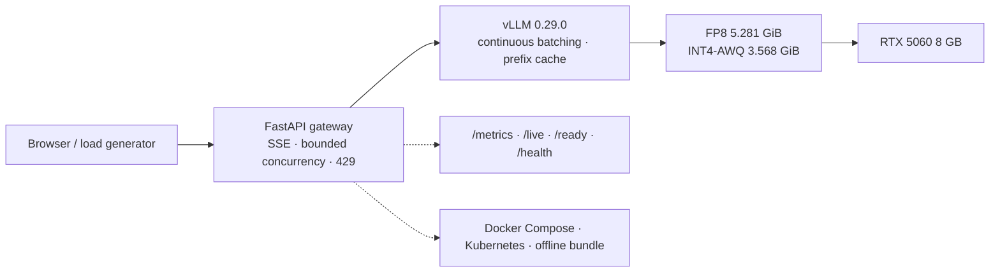

<p align="right">
  <a href="README.md"><b>English</b></a> ·
  <a href="README.zh-CN.md">简体中文</a>
</p>

# 8GB LLM Inference Delivery

Quantize, benchmark, serve, and package a 4B model on a **single RTX 5060 with 8 GB**.

This repository is one end-to-end inference delivery path: produce a quantized checkpoint that fits the GPU, measure quality and throughput, serve it behind a FastAPI gateway, and package the result with Docker/Kubernetes and reproducible evidence.


## What this is

- **Quantization under a VRAM budget** — FP8 and INT4-AWQ variants of Qwen3.5-4B generated locally with `llm-compressor`.
- **Quality evaluation** — 200 frozen C-Eval questions, per-question agreement, Wilson intervals, McNemar test, and Cohen's κ.
- **Serving engineering** — vLLM tuning, streaming gateway, admission control, timeouts, probes, metrics, and structured logs.
- **Delivery** — Docker image, Compose demo, Kubernetes manifests, offline bundle, and a deterministic test suite.

## Four numbers

| What | Result | Evidence |
|---|---:|---|
| INT4-AWQ model size | **3.568 GiB** (59% smaller than BF16) | [`benchmark/eval/README.md`](benchmark/eval/README.md) |
| Quality on 200 C-Eval questions | **141/200 (70.5%)** for all four variants; INT4 agrees with BF16 on **87.0%** | [`quantization-final-comparison.csv`](benchmark/eval/quantization-final-comparison.csv) |
| INT4-AWQ throughput at c=4 | **333.90 tok/s**, TTFT p50 **251.73 ms** | [`quantization-final-comparison.csv`](benchmark/eval/quantization-final-comparison.csv) |
| Gateway + real vLLM, 2-hour soak | **67,530 requests, 0 errors**, 9.379 rps, p95 **458.12 ms** | [`real-vllm-docker-soak-c4-7200s.json`](benchmark/results/real-vllm-docker-soak-c4-7200s.json) |

**Read the caveats.** Performance numbers are from one RTX 5060, one vLLM 0.29.0 environment, and a 16-prompt microbenchmark repeated three times. They are paired comparisons, not capacity plans. Accuracy differences on 200 questions are not significant (McNemar p=1.0); the per-question agreement is the real signal.

## Architecture



`/live` and `/ready` are process-local; `/health` checks the vLLM dependency.

## Quick start

Deterministic checks (no GPU, no model, no dataset):

```bash
python -m pip install -r gateway/requirements-dev.txt pyyaml
python scripts/verify_local.py
python scripts/validate_manifests.py   # expect: 58 Kubernetes documents
python scripts/validate_docs.py
python scripts/build_quantization_csv.py --check
```

CPU-only observability demo:

```bash
bash deploy/observability/generate-certs.sh
docker compose -f deploy/observability/compose.yaml up -d --build
# http://localhost:9000  gateway
# http://localhost:3000  Grafana (admin/admin)
# http://localhost:9090  Prometheus
```

Full GPU/vLLM path: [`docs/REPRODUCE.md`](docs/REPRODUCE.md).

## Results

### Quantization quality

Frozen C-Eval `val` set, 200 questions, 52 subjects, `temperature=0`, thinking disabled, max 8 output tokens. Calibration used the disjoint `dev` split.

| Model | Size | Accuracy | Agreement with BF16 | Fixed / broken | McNemar p | κ |
|---|---:|---:|---:|---:|---:|---:|
| BF16 reference | 8.701 GiB | 141/200 (70.5%) | 100.0% | — | — | — |
| Third-party FP8 | 5.281 GiB | 141/200 (70.5%) | 96.5% | 3 / 3 | 1.0 | 0.953 |
| Local FP8 v3 | 5.281 GiB | 141/200 (70.5%) | 98.0% | 2 / 2 | 1.0 | 0.973 |
| Local INT4-AWQ v1 | 3.568 GiB | 141/200 (70.5%) | 87.0% | 11 / 11 | 1.0 | 0.826 |

All four variants tie on total accuracy, but INT4 changes 26 answers. Equal totals do not mean equivalent models. Full table and Wilson intervals: [`docs/PERFORMANCE_REPORT.md`](docs/PERFORMANCE_REPORT.md).

### Serving

Fair vLLM benchmark: 256 input / 128 output tokens, 16 requests per run, 3 runs, `temperature=0`, compiled mode.

| Model | c=1 tok/s | c=4 tok/s | c=4 TTFT p50 | c=4 TPOT p50 |
|---|---:|---:|---:|---:|
| Third-party FP8 | 72.02 | 256.83 | 159.49 ms | 14.41 ms |
| Local FP8 v3 | 72.76 | 257.33 | 159.90 ms | 14.39 ms |
| Local INT4-AWQ v1 | **102.99** | **333.90** | 251.73 ms | 10.07 ms |

The Docker gateway measured **325.71 tok/s** mean at c=4 over three 20-request runs, with stream TTFT p50 **82.4 ms**. The 2-hour closed-loop soak completed **67,530 requests with 0 errors**.

Details and all raw files: [`docs/PERFORMANCE_REPORT.md`](docs/PERFORMANCE_REPORT.md), [`benchmark/results/INDEX.md`](benchmark/results/INDEX.md).

## Implementation boundary

| Layer | Implemented here | Delegated to |
|---|---|---|
| Quantization | calibration split, ignore list, output validation, quality/performance harness | AWQ / FP8_BLOCK algorithms and kernels: `llm-compressor` |
| Serving | FastAPI gateway, admission, SSE proxy, probes, metrics, manifests | model execution and batching: vLLM |
| Benchmarking | protocol, runner scripts, evidence index, paired statistics | measurement engine: `vllm bench serve` |
| Delivery | Dockerfile, Compose, Kubernetes, CI, checksums | base image and observability stack |

“Locally produced” means the checkpoint was generated locally with `llm-compressor`; the AWQ and FP8 algorithms are library implementations.

## Repository map

| Path | Contents |
|---|---|
| [`gateway/`](gateway/) | FastAPI gateway, web UI, Dockerfile, 37 offline tests |
| [`benchmark/eval/`](benchmark/eval/) | Frozen C-Eval set, per-question results, paired statistics |
| [`benchmark/results/`](benchmark/results/) | Raw benchmark, soak, K8s, and observability evidence |
| [`docs/PERFORMANCE_REPORT.md`](docs/PERFORMANCE_REPORT.md) | Consolidated performance and quality report |
| [`docs/BENCHMARK_PROTOCOL.md`](docs/BENCHMARK_PROTOCOL.md) | What each number means and what is not comparable |
| [`docs/K8S_VERIFICATION.md`](docs/K8S_VERIFICATION.md) | Kubernetes evidence, pod kill, rollout/rollback |
| [`docs/REPRODUCE.md`](docs/REPRODUCE.md) | CPU, Docker, and GPU reproduction paths |
| [`docs/RELEASE.md`](docs/RELEASE.md) | v0.2.4 image, digest, and deployment notes |
| [`docs/OFFLINE_BUNDLE.md`](docs/OFFLINE_BUNDLE.md) | Offline bundle contents and SHA-256 checksums |
| [`docs/LINUX_GPU_RUNBOOK.md`](docs/LINUX_GPU_RUNBOOK.md) | Native Linux GPU + Kubernetes runbook |
| [`docs/SLO.md`](docs/SLO.md) · [`docs/ALERTING.md`](docs/ALERTING.md) · [`docs/OTEL.md`](docs/OTEL.md) · [`docs/TLS.md`](docs/TLS.md) | Operations details |
| [`k8s/`](k8s/) | Gateway Deployment, Service, probes, PDB, HPA, NetworkPolicy, Prometheus |
| [`deploy/observability/`](deploy/observability/) | CPU-only Compose stack: mock vLLM, gateway, Prometheus, Grafana, Jaeger |
| [`scripts/`](scripts/) | Verification, validation, benchmark, and profiling drivers |

## Reproducibility and limitations

- **BF16 reference** was evaluated with Transformers layer placement on CPU/GPU; its latency is not comparable to GPU-resident vLLM.
- **200 multiple-choice questions** support “no accuracy difference observed here,” not model equivalence. Free-form, code, long-context, and domain data need separate evaluation.
- **The 16-prompt microbenchmark** is indicative. For capacity planning, re-run with more prompts and the profiling harness; see [`docs/BENCHMARK_PROTOCOL.md`](docs/BENCHMARK_PROTOCOL.md).
- **Kubernetes** was verified on Docker Desktop/WSL2 single-node clusters. The GPU-in-K8s path is a short smoke test, not a long-run stability claim.
- **TensorRT-LLM** was not measured; no unsupported number is claimed.
- **The offline bundle** contains model weights and is not published; checksums are published.

## Status

| Area | Status |
|---|---|
| vLLM serving, quantization, quality/performance evaluation | Done |
| FastAPI gateway, streaming, admission, auth, metrics | Done |
| Docker + Compose + offline bundle | Done (bundle not published) |
| Kubernetes gateway layer | Verified on single-node Docker Desktop/WSL2 |
| Kubernetes GPU scheduling | Short smoke only |
| Observability / SLO / alerting / OTel | Demo + documented |
| TensorRT-LLM comparison | Not measured |
| Cloud / governance | Not started |

## License

Apache-2.0. See [`LICENSE`](LICENSE).
