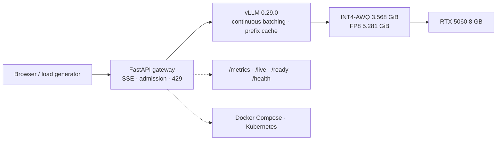

<p align="right">
  <a href="README.md"><b>English</b></a> ·
  <a href="README.zh-CN.md">简体中文</a>
</p>

[](https://github.com/francisown/4b-llm-on-8gb-gpu/actions/workflows/ci.yml)

# 4B LLM on 8GB GPU

Quantize, benchmark, serve, and package a 4B model on a single RTX 5060 with 8 GB.

This repository is one end-to-end inference delivery path: produce a quantized
checkpoint that fits the GPU, measure quality and throughput, serve it behind a
FastAPI gateway, and package the result with Docker/Kubernetes and reproducible
evidence.


## Scope

This is a **single-machine reference stack**, not a multi-tenant platform: one
RTX 5060, one vLLM upstream, and one gateway. The HPA/TLS demos use a mock
upstream and validate gateway mechanics, not model-serving high availability.

## Current verification

| What | Result | Evidence |
|---|---:|---|
| Gateway + real vLLM, 2-hour soak | **69,687 requests, 0 errors**, 9.68 rps, p50 **413.2 ms**, p95 **445.3 ms**, p99 **458.0 ms** | [`soak-c4-7200s-telemetry.json`](benchmark/results/soak-c4-7200s-telemetry.json) |
| Soak telemetry | max active **4**, max waiting **1**, GPU memory **6.99–7.33 GiB**, GPU utilization **58–98%** | same file |
| 10-minute gateway soak | **6,212 requests, 0 errors**, 10.35 rps, p95 **397.2 ms** | [`soak-c4-600s-metrics-final.json`](benchmark/results/soak-c4-600s-metrics-final.json) |
| C-Eval 200 questions, INT4 checkpoint | **142/200 (71.0%)**, 99.5% agreement with the INT4 v1 report | [new](benchmark/eval/int4-ceval-val-200.json) · [v1](benchmark/eval/self-int4-awq-v1-ceval-val-200.json) · [paired stats](benchmark/eval/int4-vs-v1-agreement.json) |
| 32-case quant-quality smoke | **25/32 (78.1%)**, strict = relaxed | [`int4-quant-quality.json`](benchmark/eval/int4-quant-quality.json) |
| Quantization comparison | BF16 **8.701 GiB** · FP8 **5.281 GiB** · INT4-AWQ **3.568 GiB**; BF16/FP8/INT4-v1 all **141/200** | [`quantization-final-comparison.csv`](benchmark/eval/quantization-final-comparison.csv) |
| Direct vLLM, INT4, c=1 / c=4 | **95.55 / 309.55 tok/s** (one run each) | [`int4-c1`](benchmark/results/int4-c1.json) · [`int4-c4`](benchmark/results/int4-c4.json) |
| Docker Desktop Kubernetes | 2 replicas, HPA 2→4→6→2, TLS `/live` + `/health` 200 | [`k8s`](benchmark/results/k8s-hpa-tls.json) · [`smoke`](benchmark/results/k8s-smoke.json) |
| Deterministic suite | **101 passed / 7 skipped** by default; **108 passed** with `CEVAL_ZIP`; coverage **78.13%** without C-Eval, **80.1%** with it | `python -m pytest -q tests` |

Performance numbers are from one RTX 5060 and one vLLM 0.29.0 environment. The
direct benchmark is a 16-prompt microbenchmark, not a capacity plan. The 200
C-Eval questions support “no accuracy difference observed here”, not model
equivalence.

## Architecture



The serving implementation is `src/llm8g/serving/`:

- `service.py` — `GatewayService`: context guard, admission lease, stream lifecycle;
- `ports.py` — `InferenceBackend` contract (`start`, `close`, `complete`, `stream`, `open_stream`, `health`);
- `http.py` — ~120-line composition root;
- `routes.py` — FastAPI routes, SSE framing, metrics;
- `transport.py` — request IDs, error mapping, disconnect cleanup;
- `dependencies.py` — API-key and rate-limit dependency;
- `metrics.py` — per-app `ServingMetrics` and CollectorRegistry.

`gateway/gateway.py` is a thin `uvicorn gateway:app` compatibility shim.

## Quick start

Deterministic checks (no GPU, no model, no dataset):

```bash
python -m pip install -e ".[web,dev]" pyyaml
python scripts/verify_local.py
python scripts/validate_manifests.py   # expect: 48 Kubernetes documents
python scripts/validate_workflows.py
python scripts/validate_docs.py
```

Run the gateway locally:

```bash
python -m pip install -e ".[web]"
PYTHONPATH=src python -m llm8g.cli serve \
  --profile configs/serving/qwen35-int4.env
```

Docker:

```bash
docker build -f gateway/Dockerfile -t ai-inference-gateway:stable .
docker compose -f gateway/compose.yaml up -d --build
```

Full GPU/vLLM path: [`docs/REPRODUCE.md`](docs/REPRODUCE.md).

## Repository map

| Path | Contents |
|---|---|
| [`src/llm8g/`](src/llm8g/) | Serving, evaluation, quantization, benchmarking, CLI |
| [`gateway/`](gateway/) | `uvicorn gateway:app` shim, Dockerfile, Compose, online smoke |
| [`configs/`](configs/) | Serving profiles and benchmark protocol |
| [`deploy/`](deploy/) | CPU observability and Kubernetes overlays |
| [`k8s/`](k8s/) | Gateway Deployment, Service, probes, PDB, HPA, NetworkPolicy, TLS demo |
| [`benchmark/`](benchmark/) | Soak/load runners and current evidence |
| [`docs/`](docs/) | Architecture, verification, performance, Kubernetes, release |
| [`tests/`](tests/) | Unit, HTTP contract, evaluation, metrics, and CLI tests |

## Limitations

- The 32-case quality set is a local regression smoke, not a benchmark.
- The 200-question C-Eval set is small; per-question agreement is more useful than a single accuracy total.
- HPA and TLS runs use the in-cluster mock vLLM, not the 4B model.
- The image is published as `ghcr.io/francisown/4b-llm-on-8gb-gpu/gateway:latest`; pin the digest for reproducible deployments.
- Authentication is optional; the gateway itself does not terminate TLS.
- Admission control and the default rate limiter are process-local; Redis is optional.
- Quantization is performed by `llm-compressor` and vLLM; the algorithms are not reimplemented here.

## Status

| Area | Status |
|---|---|
| Capability-module redesign (`src/llm8g`) | Done |
| FastAPI gateway, streaming, admission, auth, metrics | Done |
| Docker image + Compose | Built and smoke-tested locally |
| Kubernetes gateway layer | Verified on Docker Desktop; HPA/TLS smoke passed |
| Real vLLM + 4B INT4 | 2-hour soak, 0 errors |
| C-Eval / quant-quality rechecks | Done |
| GHCR image | Published (`latest`, `sha-255690f`) |
| TensorRT-LLM comparison | Not measured |

## Third-party assets

Model weights and C-Eval data are not redistributed. Set `QWEN_BF16_DIR` and
`CEVAL_ZIP` to local copies and follow the upstream terms for
[Qwen3.5-4B](https://huggingface.co/Qwen) and
[C-Eval](https://github.com/SJTU-LIT/ceval). The quantization CLI writes
`artifact-manifest.json` into the output directory, recording file sizes,
SHA-256 hashes, the source model directory name, and the algorithm/version.

## License

Apache-2.0. See [`LICENSE`](LICENSE).
