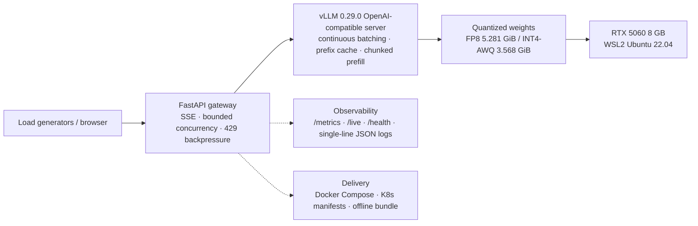

<p align="right">
  <a href="https://github.com/francisown/8gb-llm-inference-delivery/releases/tag/v0.2.4"></a>
  <a href="https://github.com/francisown/8gb-llm-inference-delivery/actions/workflows/ci.yml"></a>
  
  <a href="README.zh-CN.md"></a>
</p>

# 8GB LLM Inference Delivery

Quantize, benchmark, serve, and package a 4B model on a **single RTX 5060 with 8 GB**. This project turns model weights into a measured, runnable inference service: the model fits the memory budget, quality changes are evaluated, serving limits are exposed, and the delivery bundle can be run by someone else.

**Profile target: AI Systems / Inference Engineer** — make the model fit the hardware, then ship it as an observable, verifiable service.

`vLLM serving → concurrency benchmarking → quantization (FP8 / INT4-AWQ) → quality evaluation → KV cache & scheduling tuning → speculative decoding → FastAPI gateway → Docker offline delivery → Kubernetes`


## Start here

- [Four numbers](#four-numbers-that-define-the-delivery)
- [Reproduce in 5 minutes](#reproduce-in-5-minutes)
- [Full reproduction guide](docs/REPRODUCE.md)
- [Benchmark protocol](docs/BENCHMARK_PROTOCOL.md)
- [Kubernetes verification](docs/K8S_VERIFICATION.md)
- [Performance report](docs/PERFORMANCE_REPORT.md)

## Scope

This repository is deliberately about **one 8 GB inference delivery path**.

- **In scope:** quantization, quality evaluation, vLLM serving, FastAPI gateway,
  Kubernetes gateway layer, observability, and release/delivery.
- **Separate:** the hand-written CUDA engine lives in
  [`qwen3.5-fp8-cuda`](https://github.com/francisown/qwen3.5-fp8-cuda). The
  inference-ops agent is an experiment in
  [`experiments/inference-ops-agent/`](experiments/inference-ops-agent/) and is
  not part of the validated delivery path.

## What this project demonstrates

- **Quantization under a hard VRAM budget** — produce FP8 and self-made INT4-AWQ variants of Qwen3.5-4B that fit on an 8 GB card.
- **Evidence-based model selection** — compare model size, throughput, latency, and per-question behaviour instead of relying on one accuracy number.
- **Serving engineering** — tune continuous batching, KV cache, prefix caching, chunked prefill, and speculative decoding, then expose the model through a FastAPI gateway with streaming, timeouts, backpressure, probes, metrics, and structured logs.
- **Local delivery bundle** — package the runtime, gateway, Compose files, scripts, and checksums; the bundle was smoke-tested locally but is not published.

> **How this relates to two other repositories of mine**
>
> I also hand-wrote two inference engines from scratch — [qwen3.5-fp8-cuda](https://github.com/francisown/qwen3.5-fp8-cuda) and [Qwen3-4B-FP8-Inference](https://github.com/francisown/Qwen3-4B-FP8-Inference) — with custom fused CUDA kernels.
>
> Those are about **building an engine** (kernel level). **This repository is about shipping a model with a mature engine** (quantization tradeoffs, quality evaluation, serving, offline bundle). They are complementary.
>
> **The numbers are not comparable.** That `54 tok/s` is a single-stream hand-written engine; this `333.90 tok/s` is vLLM's batched throughput at concurrency 4. Putting them side by side is meaningless.

---

## Four numbers that define the delivery

> The front page carries three conclusions about the **delivery model (Qwen3.5-4B)** and one gateway-stability result. Qwen3-0.6B is only a test load for characterizing the engine; it is kept in Appendix A and is not a delivery-model number. For throughput caveats, see [On comparability of numbers](#on-comparability-of-numbers-important) below.

| Model | Conclusion | Number | Evidence |
|---|---|---|---|
| **Qwen3.5-4B** (delivery model) | Self-made INT4-AWQ shrinks the 4B model to | **3.568 GiB** (59% smaller than BF16, 32% smaller than FP8) | [`benchmark/eval/README.md`](benchmark/eval/README.md) |
| **Qwen3.5-4B** | Four variants score *identically* on the same 200 questions | **All 141/200 (70.5%)**, yet INT4 agrees with BF16 on only **87.0%** of questions | [`quantization-final-comparison.csv`](benchmark/eval/quantization-final-comparison.csv) |
| **Qwen3.5-4B** | INT4-AWQ output throughput at concurrency 4 | **333.90 tok/s**, TTFT p50 **251.73 ms** | [`quantization-final-comparison.csv`](benchmark/eval/quantization-final-comparison.csv) |
| **Gateway + real vLLM** | 2-hour closed-loop soak | **67,530 requests, 0 errors**, 9.379 rps, p95 **458.12 ms**, p99 639.09 ms | [`real-vllm-docker-soak-c4-7200s.json`](benchmark/results/real-vllm-docker-soak-c4-7200s.json) |

The second row is the most valuable thing this project produced: **four models scoring the same does not make them equivalent.** 200 multiple-choice questions cannot establish equivalence anyway (Wilson 95% interval 63.84%–76.39%), and INT4 picks a different option on 26 of them. That distinction is what decides whether you dare swap a quantization scheme in production.

A 7.49 GiB offline bundle containing the model, CUDA/vLLM userspace, gateway, Compose files, and checksums was built and smoke-tested locally. It is **not published** (it contains model weights), but its contents and SHA-256 checksums are published in [`docs/OFFLINE_BUNDLE.md`](docs/OFFLINE_BUNDLE.md), so a copy can be verified. The reproducible public paths are the deterministic checks and the CPU-only Compose demo.

---

## Verified deployment paths (2026-10-21)

| Path | Status | Evidence |
|---|---|---|
| **Docker + host vLLM on RTX 5060** | Verified (v0.2.4 image) | Gateway image `v0.2.4` with real Qwen3.5-4B-INT4-AWQ; 3 runs × 20 requests at c=4, 0 errors, **325.71 tok/s mean**, p95 512.92 ms; stream TTFT p50 **82.4 ms**, p95 98.47 ms; 2-hour soak **67,530 requests, 0 errors**, p95 458.12 ms, p99 639.09 ms. Raw: [`real-vllm-v0.2.4-3runs-summary.json`](benchmark/results/real-vllm-v0.2.4-3runs-summary.json) |
| **Kubernetes gateway, 2 replicas + Prometheus** | Verified (host vLLM) | 100 in-cluster requests, 0 errors, **326.53 tok/s**; 300 requests during a pod kill, **0 errors**; Prometheus scraping both pods; model server was outside the cluster |
| **GPU-in-K8s vLLM + gateway (WSL2 k3s)** | Short smoke only | vLLM pod with `nvidia.com/gpu: 1` + 2 gateway pods; 100 in-cluster requests, 0 errors, **147.17 tok/s**, p95 3.02 s; stream TTFT p50 91.8 ms. After ~6 hours the k3s node became `NotReady` (flannel/PLEG), so this is **not** long-run stable serving. See [`benchmark/results/k8s-gpu/`](benchmark/results/k8s-gpu/) |
| **HPA 2→4 / 4→2** | Verified | 8,000 requests at c=32, 0 errors; CPU 198%/60%; scale-up 45s, scale-down 90s; mock upstream, HPA mechanics only |
| **Queue-depth HPA** | Verified | 12,188 requests at c=32, 0 errors; replicas 2→4→6→5→4→3→2 on `inference_gateway_waiting_requests` via Prometheus Adapter external metrics; mock upstream, gateway queue only |
| **Rollout / rollback** | Verified | Bad `v2` image stuck in `ImagePullBackOff`; both old replicas kept serving; `rollout undo` recovered |
| **TensorRT-LLM comparison** | Not measured | TensorRT-LLM 1.2.1 support matrix does not cover Qwen3.5 or RTX 5060/SM120, and its CUDA/torch requirements differ; no unsupported benchmark is claimed. See [`docs/RUNTIME_COMPARISON.md`](docs/RUNTIME_COMPARISON.md) |

The detailed commands, raw results, and limitations are in
[`docs/K8S_VERIFICATION.md`](docs/K8S_VERIFICATION.md) and
[`benchmark/results/k8s-gpu/`](benchmark/results/k8s-gpu/). The original gateway
benchmark used a host vLLM; the WSL2 k3s run also put vLLM inside the cluster.
The latter is functionally verified for a short smoke test, but its throughput
and tail latency are much worse than the host path, so it is not a production
or parity claim.

---

## Architecture



The diagram shows the original host-vLLM path. The WSL2 k3s variant that puts
vLLM and the gateway in-cluster is in
[`k8s/gpu-inference/`](k8s/gpu-inference/); its measured performance is lower
than the host path.

---

## Key results

Every number applies only to this hardware, vLLM 0.29.0, and the stated test conditions. Do not extrapolate to other GPUs or long-context workloads.

### 1. Quantization, three ways: identical totals, different behaviour

A frozen C-Eval `val` set of 200 questions (52 subjects, sample SHA-256 `8df8746b…c941`), calibrated on the disjoint `dev` split; prompts, question order, answer parsing, `temperature=0`, thinking disabled, and max 8 output tokens all held constant.

| Model | Directory size | Accuracy | Per-question agreement with BF16 | Fixed BF16 errors | Broke BF16 correct answers |
|---|---:|---:|---:|---:|---:|
| BF16 reference | 8.701 GiB | 141/200 (70.5%) | 100.0% | — | — |
| Third-party FP8 | 5.281 GiB | 141/200 (70.5%) | 96.5% | 3 | 3 |
| **Self-made FP8 v3** | 5.281 GiB | 141/200 (70.5%) | **98.0%** | 2 | 2 |
| **Self-made INT4-AWQ v1** | 3.568 GiB | 141/200 (70.5%) | 87.0% | 11 | 11 |

All four score exactly 141/200. Read only that column and you conclude "INT4 is lossless." It is not: INT4 picks a different option on 26 questions, breaking 11 BF16-correct answers while fixing 11 BF16-wrong ones — the errors cancel in the total.

Performance, same fair benchmark (256-in / 128-out, 16 requests, `temperature=0`, compiled mode). **The table below is the mean of 3 runs per configuration within one session (n=3):**

| Model | Directory size | Concurrency | Output throughput (mean of 3) | Within-session range | TTFT P50 | TPOT P50 |
|---|---:|---:|---:|---:|---:|---:|
| Third-party FP8 | 5.281 GiB | 1 | 72.02 tok/s | 1.3% | 47.92 ms | 13.57 ms |
| Third-party FP8 | 5.281 GiB | 4 | 256.83 tok/s | 0.1% | 159.49 ms | 14.41 ms |
| Self-made FP8 v3 | 5.281 GiB | 1 | 72.76 tok/s | 0.1% | 48.11 ms | 13.46 ms |
| Self-made FP8 v3 | 5.281 GiB | 4 | 257.33 tok/s | 0.1% | 159.90 ms | 14.39 ms |
| **Self-made INT4-AWQ v1** | **3.568 GiB** | 1 | **102.99 tok/s** | 0.1% | 72.24 ms | 9.21 ms |
| **Self-made INT4-AWQ v1** | **3.568 GiB** | 4 | **333.90 tok/s** | 0.6% | 251.73 ms | 10.07 ms |

Within-session range peaks at 1.3% and is mostly 0.1%, so this batch is internally consistent. That is **precision inside one session, not external validity**: the cross-batch drift documented below means the absolute values should not be treated as universal.

**Selection conclusion:**

- **To trade size and speed on 8 GB → self-made INT4-AWQ.** Versus third-party FP8 it gains **+43.0%** throughput at concurrency 1 and **+30.0%** at concurrency 4, stable in direction and magnitude across three measurement rounds. The cost is a lower per-question agreement with BF16 (87.0% vs 96.5%), and that cost has to be evaluated on your own data.
- **To stay closer to BF16's behaviour → self-made FP8 v3.** Its advantage is **quality only** (98.0% vs 96.5% per-question agreement with BF16). **Its throughput is equivalent within the observed run-to-run range** (+1.0% / +0.2%, both inside the within-session spread; no formal hypothesis test was run).

> Earlier versions of these docs claimed "self-made FP8 v3 is also slightly faster than third-party FP8." Two independent measurement rounds contradict that, and **the claim has been removed from every document**. Saying "the two are equivalent" now rests on three repetitions; the old claim rested on a single run.

### 2. Speculative decoding: big win, will not fit

In a fair comparison, MTP-5 lifted concurrency-4 throughput from 104.26 to 351.37 tok/s. Weighing TTFT, throughput, and acceptance rate, **MTP-4 is the better choice**. But 8 GB cannot hold the production context length, higher concurrency, CUDA Graph, and aggressive MTP at once — combining MTP with CUDA Graph produced a KV cache budget of **−1.03 GiB**, which will not start. The stable delivery bundle therefore falls back to a more conservative N-gram configuration.

That conclusion is itself a result: **the optimal configuration and the shippable configuration are not the same thing.**

### 3. Production gateway and delivery

`gateway/` sits between clients and vLLM:

- Browser chat UI, non-streaming `POST /chat`, SSE streaming `POST /chat/stream` (with TTFT and end-to-end latency)
- Request-ID propagation, Pydantic validation, Unicode sanitization
- Four independent timeout classes (connect / read / write / pool); upstream error translation; upstream cancellation when the client disconnects
- Bounded concurrency and queueing with **HTTP 429 backpressure**
- Optional `Authorization: Bearer` / `X-API-Key` authentication for chat endpoints; `/live`, `/health`, and `/metrics` stay open for probes and Prometheus
- Optional per-identity rate limit (`GATEWAY_RATE_LIMIT_PER_MINUTE`), keyed by API key or client IP
- Connect-only upstream retry: a failed pre-send connection is retried, a read timeout is never replayed
- Split `/live` (process) and `/health` (upstream dependency); `/gateway/status` for in-flight and queued counts
- Health checks use `Connection: close` and disable keep-alive reuse, after a real `RemoteProtocolError` flap found on Kubernetes
- Prometheus counters, gauges, and latency histograms; `X-Gateway-Pod` / `X-Gateway-Version` response headers; single-line JSON logs
- **19 pytest cases needing neither a model nor a GPU**, covering success, validation failure, upstream timeout / disconnect / HTTP error, capacity rejection, queue timeout, connect retry, probe identity, optional API-key authentication, and per-identity rate limiting
- Non-root Docker image + Compose; Kubernetes Deployment with 2 replicas, PDB, zero-downtime rollout, and per-pod Prometheus scraping

The local offline bundle packs the model, the vLLM/PyTorch/CUDA userspace environment, the gateway, Compose, one-click scripts, and SHA-256 manifests into **7.49 GiB**. It was exercised end to end on this host (image import, GPU check, model startup, browser chat), but it is not published, so a reader cannot independently verify it.

The Kubernetes path was verified separately on 2026-10-21: 100 in-cluster
requests at concurrency 4 completed with **0 errors** and **326.53 tok/s**;
300 requests during a deliberate pod kill completed with **0 errors**; a bad
image tag left both old replicas serving and `rollout undo` recovered. The GPU
itself was not schedulable by that cluster. See
[`docs/K8S_VERIFICATION.md`](docs/K8S_VERIFICATION.md).

---

## Appendix A · Engine batching baseline (Qwen3-0.6B — a test load, not the delivery model)

**This section characterizes the engine, not a model.** It is not part of the deliverable; it exists to isolate how continuous batching converts concurrency into throughput, and at what cost.

Why a light load is mandatory: to observe batching's own scaling, the load must not become the bottleneck first. Qwen3-0.6B under `--max-model-len 4096 --gpu-memory-utilization 0.70` reaches concurrency 64; the 4B delivery model cannot do that on 8 GB with `max-num-seqs 16` — VRAM and KV cache hit the wall first.

**So its numbers say nothing about the delivery model's performance, and the two cannot be used to explain each other.** Fixed at 256 input / 128 output, 64 requests:

> The table below is a **single run**, not 3 repetitions (unlike the two delivery-model tables). This appendix's conclusion depends only on the trend — throughput rising sharply with concurrency while latency degrades — not on the exact values, so one run suffices. But **do not quote these absolute values as precise.**

| Client concurrency | Output throughput | TTFT P50 | TTFT P95 | TPOT P50 | Success |
|---:|---:|---:|---:|---:|---:|
| 1 | 265.76 tok/s | 14.95 ms | 15.51 ms | 3.67 ms | 100% |
| 4 | 898.85 tok/s | 18.02 ms | 23.64 ms | 4.32 ms | 100% |
| 16 | 2,811.97 tok/s | 33.84 ms | 41.88 ms | 5.47 ms | 100% |
| 64 | 5,693.04 tok/s | 94.50 ms | 120.18 ms | 10.48 ms | 100% |


From concurrency 1 to 64, total throughput rises 21.4× while per-request TPOT rises 2.9× and TTFT rises 6.3×. **"Accepts 64 concurrent requests" and "64 users each keep single-user latency" are two different claims** — capacity planning has to treat this curve as a tradeoff, not a ceiling.

That conclusion is independent of the model generation, and it is the only thing worth reading in this appendix.

---

## Reproduce in 5 minutes

```bash
# 1. Deterministic checks (no GPU, no model, no API key)
python -m pip install -r gateway/requirements-dev.txt pyyaml
python scripts/verify_local.py          # expect: 5 cost tests + 26 gateway tests
python scripts/validate_manifests.py    # expect: 58 Kubernetes documents

# 1b. Quality gates (the same commands CI runs)
python -m ruff check gateway tools tests                    # expect: All checks passed
python -m mypy gateway/gateway.py                           # expect: no issues found
python -m pytest -q gateway --cov=gateway --cov-fail-under=80

# 2. Recompute throughput and cost from the raw JSON (run at repo root)
python tools/cost_calculator.py \
  --benchmark-json benchmark/results/qwen35-int4-awq-self-compiled-c4.json \
  --gpu-hour-price 1 --currency CNY

# 3. Kubernetes path (needs a cluster; full commands in docs/K8S_VERIFICATION.md)
kubectl apply -k k8s
kubectl apply -k k8s/observability
```

The full pipeline (needs a GPU + WSL2 + vLLM) is documented in [`docs/REPRODUCE.md`](docs/REPRODUCE.md) and the "Reproducible environment" section of [`docs/project-notes.md`](docs/project-notes.md). The four per-question quantization result files live in [`benchmark/eval/`](benchmark/eval/); all raw performance JSON is in [`benchmark/results/`](benchmark/results/).

## Release

- Latest: **v0.2.4** — [release notes](https://github.com/francisown/8gb-llm-inference-delivery/releases/tag/v0.2.4)
- Image: `ghcr.io/francisown/8gb-llm-inference-delivery/gateway:v0.2.4`
- Digest: `sha256:4453ef462ac426b6abe239819d41a4171454f7ebffacaf90ffb481a8f95e1365`
- Details: [`docs/RELEASE.md`](docs/RELEASE.md)

The original K8s gateway benchmark was measured on **v0.2.0**; v0.2.1 adds API-key auth, v0.2.2 adds TLS/alerting/OTel, v0.2.3 adds per-identity rate limiting, and v0.2.4 hardens auth/rate-limit identity handling and malformed-upstream responses without changing the serving path.

## Observability demo (no GPU)

The CPU-only stack uses a mock OpenAI-compatible upstream, so it validates the metric pipeline without model weights:

```bash
bash deploy/observability/generate-certs.sh
docker compose -f deploy/observability/compose.yaml up -d --build
# Grafana:    http://localhost:3000  (admin/admin)
# Prometheus: http://localhost:9090
# Alertmanager: http://localhost:9093
# Webhook:    http://localhost:8080  (alert receiver)
# Jaeger:     http://localhost:16686
# HTTPS:      https://localhost:9443  (self-signed; curl -k)
# Gateway:    http://localhost:9000
```

The provisioned dashboard shows request rate/errors, TTFT p50/p95, end-to-end latency, queue wait, admission control, upstream health, completion tokens/s, and gateway replicas. For the real GPU path, point `VLLM_BASE_URL` at the vLLM server instead of the mock.

A repeatable gateway soak is included:

```bash
python benchmark/soak_test.py --url http://127.0.0.1:9000/chat \
  --duration 120 --concurrency 4 \
  --output benchmark/results/observability/soak-c4-120s.json
```

---

## Repository map

> **Naming convention:** every path in this repository **is named by function, never by time.** Earlier versions used labels like `week1/` and `week6_api/` from an original week-by-week plan; those are gone. Time labels inevitably become wrong once a project spans more than one phase — `week1` ended up covering every module — whereas a functional name does not expire.

| Path | Contents |
|---|---|
| [`docs/article-quantization-on-8gb-zh.md`](docs/article-quantization-on-8gb-zh.md) · [`docs/article-quantization-on-8gb-en.md`](docs/article-quantization-on-8gb-en.md) | **Long-form write-up (Chinese / English)**: the full quantization and investigation story, including three retracted conclusions |
| [`docs/one-pager-zh.md`](docs/one-pager-zh.md) · [`docs/one-pager-en.md`](docs/one-pager-en.md) | One-pager summary (Chinese / English), for outreach |
| [`docs/parameter-decisions.md`](docs/parameter-decisions.md) | Why each inference parameter has the value it has, and which numbers are safe to quote |
| [`docs/wsl2-runner-verification.md`](docs/wsl2-runner-verification.md) | Full investigation log: the WSL2 model-runner question and the cross-batch reproducibility finding |
| [`docs/project-notes.md`](docs/project-notes.md) | Detailed project notes: module status, reproducible environment, quantization and speculative-decoding detail |
| [`docs/K8S_VERIFICATION.md`](docs/K8S_VERIFICATION.md) | What was actually deployed and measured on Kubernetes, including the GPU-scheduling boundary |
| [`docs/RUNTIME_COMPARISON.md`](docs/RUNTIME_COMPARISON.md) | vLLM / TensorRT-LLM / custom-CUDA comparison status and why some rows are not comparable |
| [`docs/K3S_GPU_EXPERIMENT.md`](docs/K3S_GPU_EXPERIMENT.md) | WSL2 k3s GPU attempt: PLEG failure, the VLLM_PORT fix, and the short successful validation |
| [`docs/LINUX_GPU_RUNBOOK.md`](docs/LINUX_GPU_RUNBOOK.md) | Step-by-step native Linux GPU node path: driver, toolkit, device plugin, PVC, vLLM, TensorRT-LLM |
| [`docs/PERFORMANCE_REPORT.md`](docs/PERFORMANCE_REPORT.md) | Concise performance report with quantization, K8s gateway, failure, and non-claims |
| [`docs/BENCHMARK_PROTOCOL.md`](docs/BENCHMARK_PROTOCOL.md) | Single protocol matrix for every headline number and comparability rules |
| [`benchmark/README.md`](benchmark/README.md) | Which benchmark/eval files are authoritative and which are historical |
| [`scripts/README.md`](scripts/README.md) | Script inventory: current checks, experiment drivers, and historical tools |
| [`CHANGELOG.md`](CHANGELOG.md) | Versioned changes and release notes |
| [`docs/FLAGSHIP_PLAN.md`](docs/FLAGSHIP_PLAN.md) | Current flagship plan and verification checklist |
| [`benchmark/eval/`](benchmark/eval/) | Frozen 200-question set, per-question results for four models, combined comparison table |
| [`benchmark/results/`](benchmark/results/) | All raw evidence; start at [`INDEX.md`](benchmark/results/INDEX.md) to find the current file behind each claim |
| [`benchmark/results/k8s-gpu/`](benchmark/results/k8s-gpu/) | WSL2 k3s GPU-in-K8s vLLM + gateway validation and raw results |
| [`benchmark/hpa/README.md`](benchmark/hpa/README.md) | HPA 2→4→2 validation with mock upstream, metrics-server, and load Job |
| [`benchmark/hpa-queue/README.md`](benchmark/hpa-queue/README.md) | Queue-depth HPA 2→4→6→2 through Prometheus Adapter external metrics |
| [`benchmark/k8s_load_test.py`](benchmark/k8s_load_test.py) | In-cluster / port-forward load generator with TTFT, latency percentiles, error rate, and per-pod counts |
| [`benchmark/soak_test.py`](benchmark/soak_test.py) | Closed-loop gateway soak with latency percentiles, error rate, and active/waiting gauge recovery |
| [`gateway/`](gateway/) | FastAPI gateway, web UI, Dockerfile, offline pytest suite |
| [`k8s/`](k8s/) | Gateway Deployment / Service / ConfigMap / probes / PDB / HPA / NetworkPolicy / Prometheus / load-test Job |
| [`k8s/gpu-inference/`](k8s/gpu-inference/) | WSL2 k3s manifests for vLLM-on-GPU + 2 gateway replicas |
| [`k8s/tls-demo/`](k8s/tls-demo/) | Nginx TLS terminator and enforced NetworkPolicy on Docker Desktop Kubernetes |
| [`k8s/hpa-queue-demo/`](k8s/hpa-queue-demo/) | Queue-depth HPA via Prometheus Adapter external metrics |
| [`docs/SLO.md`](docs/SLO.md) | SLO targets, PromQL queries, error-budget policy, and dashboard link |
| [`docs/TLS.md`](docs/TLS.md) | Local TLS terminator, verification, and production guidance |
| [`docs/K8S_TLS.md`](docs/K8S_TLS.md) | Kubernetes TLS termination and the NetworkPolicy toggle matrix |
| [`docs/HPA_QUEUE.md`](docs/HPA_QUEUE.md) | Queue-depth HPA, external-metric configuration traps, and scale test |
| [`docs/ALERTING.md`](docs/ALERTING.md) | Prometheus alert rules, verification, and runbook |
| [`docs/OTEL.md`](docs/OTEL.md) | Jaeger tracing, OTLP configuration, verification, and limits |
| [`docs/RELEASE_CHECKLIST.md`](docs/RELEASE_CHECKLIST.md) | Pre-release, canary, rollback, artifacts, and post-release checklist |
| [`docs/REPRODUCE.md`](docs/REPRODUCE.md) | Three reproduction levels, environment versions, and known gaps |
| [`docs/OFFLINE_BUNDLE.md`](docs/OFFLINE_BUNDLE.md) | 7.49 GiB offline bundle contents, SHA-256 checksums, and verification transcript |
| [`requirements-quant.txt`](requirements-quant.txt) | Human-readable quantization starting point |
| [`requirements-quant.lock.txt`](requirements-quant.lock.txt) | Actual pip freeze of the quantization/evaluation environment (88 packages) |
| [`requirements-vllm.lock.txt`](requirements-vllm.lock.txt) | Actual pip freeze of the vLLM serving environment (205 packages) |
| [`docs/RELEASE.md`](docs/RELEASE.md) | v0.2.4 tag, GHCR image, release verification, and deployment notes |
| [`experiments/inference-ops-agent/`](experiments/inference-ops-agent/) | Optional inference-ops agent experiment; not part of the validated delivery path |
| [`SECURITY.md`](SECURITY.md) | Vulnerability reporting, secrets policy, scope, and known limitations |
| [`CONTRIBUTING.md`](CONTRIBUTING.md) | Local checks, observability demo, soak test, PR checklist, and release flow |
| [`.github/workflows/release.yml`](.github/workflows/release.yml) | Tag-triggered GHCR image build and publish |
| [`deploy/observability/`](deploy/observability/) | CPU-only Compose demo: mock vLLM + gateway + Prometheus + provisioned Grafana dashboard |
| [`.github/workflows/ci.yml`](.github/workflows/ci.yml) | Tests, manifest/workflow validation, Kustomize render, and Docker build |
| [`scripts/validate_workflows.py`](scripts/validate_workflows.py) | Deterministic GitHub Actions YAML validation |
| [`quantize_fp8_block.py`](quantize_fp8_block.py) | FP8_BLOCK quantization script |
| [`quantize_int4_awq.py`](quantize_int4_awq.py) | W4A16 INT4-AWQ quantization (C-Eval calibration, per-layer calibration, CPU offload) |
| [`ceval_quality_eval.py`](ceval_quality_eval.py) | Evaluation entry point: frozen question set, resume support, atomic per-question saving |
| [`docs/int4-awq-experiment-log.md`](docs/int4-awq-experiment-log.md) | AWQ experiment log, including the pitfalls and their fixes |
| [`tools/cost_calculator.py`](tools/cost_calculator.py) | Capacity cost estimation (reads benchmark JSON directly) |

---

## What this repository is, and is not

**It is:** one person taking inference serving all the way through quantization, tuning, service packaging, and delivery on a single 8 GB consumer card — with reproducible raw data left behind at every step.

**It is not:** a paper reproduction, model training, or a production system with an SLA. Specifically:

- The BF16 8.701 GiB checkpoint does not fit in 8 GB. It ran layer-wise on CPU via Transformers at a fixed batch size of 4 as a quality baseline only — **its local latency is not comparable to a GPU-resident vLLM model.**
- 200 multiple-choice questions support only "no accuracy difference observed on these 200 questions." They are **not** sufficient to establish model equivalence; free-form text, code, long context, and real domain data each need separate evaluation.
- The cost calculator is a capacity-cost estimate. It excludes idle fluctuation, networking, storage, labour, tax, redundancy, and margin, and **cannot stand in for a cloud API quote.**
- **Pinned memory is supported on WSL2 — vLLM merely disables it by default.** Set `VLLM_WSL2_ENABLE_PIN_MEMORY=1` and the server logs `Using V2 Model Runner`. Measured, V2 and V1 are performance-equivalent (concurrency 1: −0.3%; concurrency 4: −0.1%). Separately, this machine has no full CUDA Toolkit, so FlashInfer's first-use JIT fails and `VLLM_USE_FLASHINFER_SAMPLER=0` is required. These are environment-specific settings, not general advice. Details in [`docs/wsl2-runner-verification.md`](docs/wsl2-runner-verification.md).
- **The gateway is one 989-line module.** Eight routes, admission control, rate limiting, and the SSE path all read from the same file. It is a deliberate trade for a single-process service, not an oversight, but it is a real cost: adding a second upstream provider would mean editing three unrelated regions. Splitting it into a package would simultaneously change the Dockerfile `COPY`, the uvicorn entry point (`gateway:app`), and the pytest `sys.path`, so it is deferred rather than dismissed. The streaming path now has direct tests, which was the actual risk.

### On comparability of numbers (important)

Performance figures in this repository are only trustworthy when they come from **the same batch, with at least 3 runs per configuration.**

**How that rule came about:** figures recorded on 2026-09-17 were re-measured on 2026-09-22 with identical parameters (`num_prompts`, concurrency, input/output lengths, `completed`, `failed` all verified element by element). They did not match — and **they did not fail to match uniformly**:

| Configuration | Concurrency 1 | Concurrency 4 |
|---|---:|---:|
| Qwen3.5-4B **third-party FP8** | **+0.7%** | **+2.6%** |
| Qwen3.5-4B self-made FP8 v3 | −7.2% | −5.7% |
| Qwen3.5-4B self-made INT4-AWQ | −5.6% | −7.2% |
| Qwen3-0.6B (concurrency 1/4/16/64) | −7.6% / −6.1% / +2.2% / −7.3% | |

(Numbers are 3-run means. A positive percentage means the new value is higher. **This does not establish which batch is "more correct"** — only that the old values do not reproduce in the current environment.)

**Third-party FP8 barely moved; both self-made quantized models came in 6–7% lower.** If the whole machine had simply slowed down, third-party FP8 would have dropped too. So this is not a single environmental factor — it correlates with the quantization kernel path (both self-made models run compressed-tensors + Marlin).

**Hypothesis eliminated: thermal throttling.** The recorded GPU state was `throttle_reasons = 0x0000000000000000` (no throttling of any kind), 49–64 °C, 78–105 W against a 145 W limit, and an SM clock that rose from 2535 to 2752 MHz over the session. **"The GPU throttled" is dead.**

**Cause still unknown:** the candidate is a difference in kernel autotuning or warmup state between batches. **Unverified**, so not used as a conclusion.

**The difference is real, not a one-off fluctuation** — repeated measurement settled it:

| Configuration | Within-session range over 3 samples |
|---|---:|
| Third-party FP8 (concurrency 1 / 4) | 1.3% / 0.1% |
| Self-made FP8 v3 (concurrency 1 / 4) | 0.1% / 0.1% |
| Self-made INT4 (concurrency 1 / 4) | 0.1% / 0.6% |

A within-session range as small as 0.1%, yet a consistent 6–7% departure from the old values. **The old values are not "unlucky" — they simply do not reproduce under the current configuration.**

**A methodology point this exposed:** a single run is unreliable, **even on the same day.** Earlier that day, a single run of self-made FP8 v3 at concurrency 4 gave 246.66, while the 3-run mean was 257.33 — a 4.3% deviation, far outside its own 0.1% within-session range. The first round of a session also tends to read low (third-party FP8 at concurrency 1: 71.5 on the first round vs 72.2 and 72.4 afterwards), which looks like a warmup effect.

> **Resulting rule: any performance figure quoted externally is the mean of at least 3 runs per configuration, measured within one batch.** The tables above follow it.

**How the relative relationships moved:**

| Relationship | 2026-09-17 | 2026-09-22 (3-run means) |
|---|---:|---:|
| Self-made INT4 ÷ third-party FP8 (concurrency 1) | 1.53× | 1.43× |
| Self-made INT4 ÷ third-party FP8 (concurrency 4) | 1.44× | 1.30× |
| Self-made FP8 v3 ÷ third-party FP8 (concurrency 1) | 1.10× | 1.01× |
| Self-made FP8 v3 ÷ third-party FP8 (concurrency 4) | 1.09× | **1.00×** |

- INT4's advantage narrowed from about +52.6% / +43.7% to **+43.0% / +30.0%**, stable in direction and magnitude
- "Self-made FP8 v3 is slightly faster than third-party FP8" **has been retracted.** Two independent rounds now agree: **the two are throughput-equivalent**, so the selection must rest on quality alone

**Conclusions unaffected:** size reduction, the 200-question agreement rates, memory-budget arithmetic, and the reasoning behind parameter choices — none of these are throughput measurements, and none move between batches.

The full investigation, the raw GPU state records, and every script are in [`docs/wsl2-runner-verification.md`](docs/wsl2-runner-verification.md).

---

## Reproducible environment

| Item | Version |
|---|---|
| Host | Windows + WSL2 (Ubuntu 22.04) |
| GPU | NVIDIA GeForce RTX 5060 8 GB |
| Inference engine | vLLM 0.29.0 |
| PyTorch | 2.13.0+cu130 |
| CUDA runtime | 13.0 |

Model weights and datasets are not committed (see `.gitignore`).

---

## Status

| Area | Status |
|---|---|
| vLLM internals, concurrency benchmarking, FP8/INT4 quantization, quality evaluation, KV cache & scheduling, production gateway, Docker offline delivery, cost model | Done |
| Kubernetes gateway layer | **Verified 2026-10-21**: 2 replicas, Service, probes, PDB, zero-downtime rollout/rollback, per-pod Prometheus, HPA 2→4→2; 100 requests at 0 errors, 300 requests during a pod kill at 0 errors. See [`docs/K8S_VERIFICATION.md`](docs/K8S_VERIFICATION.md) and [`benchmark/hpa/README.md`](benchmark/hpa/README.md) |
| Kubernetes GPU scheduling | **Short smoke only**: node advertised `nvidia.com/gpu: 1`; vLLM pod served real Qwen3.5-4B-INT4-AWQ; 2 gateway pods; 100 in-cluster requests, 0 errors, 147.17 tok/s, p95 3.02 s. After ~6 h the WSL2 k3s node became `NotReady` (flannel/PLEG), so long-run GPU serving is **not** claimed. See [`benchmark/results/k8s-gpu/`](benchmark/results/k8s-gpu/) |
| Observability & SRE | Prometheus/Grafana/Alertmanager with real webhook delivery (firing and resolved POSTs recorded), SLO/error-budget docs, a 2-hour real-vLLM soak (67,530 requests, 0 errors, p95 458.12 ms), a 2-hour mock-gateway soak (140,178 requests, 0 errors), c=16 backpressure, and OTel/Jaeger with badger persistence; still no multi-hour GPU-in-Kubernetes soak |
| CI/CD | CI (tests, manifest/workflow/docs validation, Kustomize render, Docker build), a tag-triggered GHCR release workflow (v0.2.4 published); no image signing or automated deployment yet |
| TensorRT-LLM | Not measured; comparison protocol and harness documented in [`docs/RUNTIME_COMPARISON.md`](docs/RUNTIME_COMPARISON.md) |
| Cloud & governance | Not started |

The v0.2.4 gateway was re-run against the real model: 20 requests at c=4 with 0 errors, 327.51 tok/s, stream TTFT p50 85.5 ms. If the offline bundle is republished, refresh its gateway image and SHA-256 manifests.
