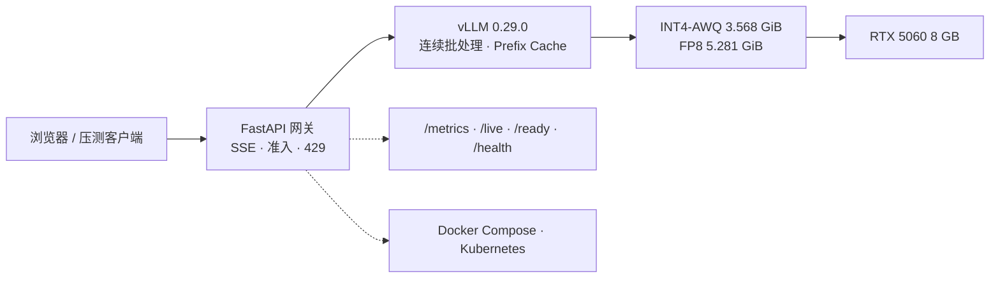

<p align="right">
  <a href="README.md">English</a> ·
  <a href="README.zh-CN.md"><b>简体中文</b></a>
</p>

# 8GB 大模型推理交付

在**单张 RTX 5060 8GB** 上，把 Qwen3.5-4B 从量化、质量评测一路做到 vLLM 服务、FastAPI 网关、Docker/Kubernetes 交付。


## 当前验证

| 项目 | 结果 | 证据 |
|---|---:|---|
| 网关 + 真实 vLLM 2 小时 soak | **69,687 请求，0 错误**，9.68 rps，p50 **413.2 ms**，p95 **445.3 ms**，p99 **458.0 ms** | [`soak-c4-7200s-telemetry.json`](benchmark/results/soak-c4-7200s-telemetry.json) |
| Soak telemetry | 最大 active **4**，最大 waiting **1**，GPU 显存 **6.99–7.33 GiB**，GPU 利用率 **58–98%** | 同上 |
| 10 分钟网关 soak | **6,212 请求，0 错误**，10.35 rps，p95 **397.2 ms** | [`soak-c4-600s-metrics-final.json`](benchmark/results/soak-c4-600s-metrics-final.json) |
| C-Eval 200 题，INT4 | **142/200（71.0%）**，与 v1 报告逐题一致率 99.5% | [`int4-ceval-val-200.json`](benchmark/eval/int4-ceval-val-200.json) |
| 32 题量化质量 | **25/32（78.1%）**，strict = relaxed | [`int4-quant-quality.json`](benchmark/eval/int4-quant-quality.json) |
| 直接 vLLM，INT4，c=1 / c=4 | **95.55 / 309.55 tok/s** | [`r3-c1`](benchmark/results/int4-r3-c1.json) · [`r3-c4`](benchmark/results/int4-r3-c4.json) |
| Docker Desktop Kubernetes | 2 副本，HPA 2→4→6→2，TLS `/live` + `/health` 200 | [`k8s`](benchmark/results/k8s-hpa-tls.json) · [`smoke`](benchmark/results/k8s-smoke.json) |
| 确定性测试 | 默认 **100 passed / 7 skipped**；设置 `CEVAL_ZIP` 后 **107 passed**；覆盖率无 C-Eval 为 **78.03%**，含 C-Eval 为 **80.03%** | `python -m pytest -q tests` |

性能数字来自单张 RTX 5060 和单一 vLLM 0.29.0 环境。直接 benchmark 是 16 prompts 微基准，不是容量规划。200 题 C-Eval 只能说明“在这 200 题上没观察到准确率差异”，不等于模型等价。

## 架构



Serving 实现在 `src/llm8g/serving/`：

- `service.py`：`GatewayService`，负责上下文限制、准入租约、流式生命周期；
- `ports.py`：`InferenceBackend` 契约（`start`、`close`、`complete`、`stream`、`open_stream`、`health`）；
- `http.py`：约 120 行 composition root；
- `routes.py`：FastAPI 路由、SSE、指标；
- `transport.py`：request ID、错误映射、断连清理；
- `dependencies.py`：API key / 限流依赖；
- `metrics.py`：per-app `ServingMetrics` 和 CollectorRegistry。

`gateway/gateway.py` 是 `uvicorn gateway:app` 的薄兼容层。

## 快速开始

确定性检查（不需要 GPU、模型或数据集）：

```bash
python -m pip install -e ".[web,dev]" pyyaml
python scripts/verify_local.py
python scripts/validate_manifests.py   # 预期：48 个 Kubernetes 文档
python scripts/validate_workflows.py
python scripts/validate_docs.py
```

本地启动网关：

```bash
python -m pip install -e ".[web]"
PYTHONPATH=src python -m llm8g.cli serve \
  --profile configs/serving/qwen35-int4.env
```

Docker：

```bash
docker build -f gateway/Dockerfile -t ai-inference-gateway:stable .
docker compose -f gateway/compose.yaml up -d --build
```

完整 GPU/vLLM 路径见 [`docs/REPRODUCE.md`](docs/REPRODUCE.md)。

## 目录

| 路径 | 内容 |
|---|---|
| [`src/llm8g/`](src/llm8g/) | serving、evaluation、quantization、benchmarking、CLI |
| [`gateway/`](gateway/) | `uvicorn gateway:app` 兼容层、Dockerfile、Compose、在线 smoke |
| [`configs/`](configs/) | serving profile 和 benchmark 协议 |
| [`deploy/`](deploy/) | CPU observability 和 Kubernetes overlays |
| [`k8s/`](k8s/) | Gateway Deployment、Service、探针、PDB、HPA、NetworkPolicy、TLS demo |
| [`benchmark/`](benchmark/) | soak/load runner 和当前证据 |
| [`docs/`](docs/) | 架构、验证、性能、Kubernetes、发布 |
| [`tests/`](tests/) | 单元、HTTP 合约、评测、指标、CLI 测试 |

## 限制

- 32 题质量集是本地回归 smoke，不是 benchmark；
- 200 题 C-Eval 样本很小，逐题一致率比总准确率更有意义；
- HPA/TLS 使用集群内 mock vLLM，不是 4B 模型；
- 本地镜像尚未发布到 GHCR；
- 认证可选，gateway 本身不做 TLS；
- 默认限流和准入是进程内；Redis 可选；
- 量化由 `llm-compressor` 和 vLLM 完成，算法不是本项目重新实现。

## 状态

| 领域 | 状态 |
|---|---|
| `src/llm8g` 能力分层 | 完成 |
| FastAPI 网关、流式、准入、认证、指标 | 完成 |
| Docker + Compose | 本地构建并 smoke 通过 |
| Kubernetes 网关层 | Docker Desktop 验证；HPA/TLS smoke 通过 |
| 真实 vLLM + 4B INT4 | 2 小时 soak，0 错误 |
| C-Eval / 量化质量复测 | 完成 |
| GHCR 镜像 | 未发布 |
| TensorRT-LLM 对比 | 未测 |

## License

Apache-2.0。见 [`LICENSE`](LICENSE)。
