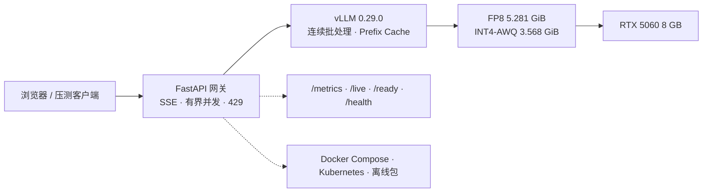

<p align="right">
  <a href="README.md">English</a> ·
  <a href="README.zh-CN.md"><b>简体中文</b></a>
</p>

# 8GB 大模型推理交付

在**单张 RTX 5060 8GB** 上，把 Qwen3.5-4B 从量化、质量评测一路做到 vLLM 服务、FastAPI 网关、Docker/Kubernetes 交付。

这个仓库只讲一条端到端的推理交付路径：让模型装进显存，测出质量和吞吐，用网关把它服务化，再把结果打包成可复现的交付物。


## 这个项目是什么

- **显存预算下的量化**：用 `llm-compressor` 在本地生成 FP8 和 INT4-AWQ 版本的 Qwen3.5-4B。
- **质量评测**：200 道冻结的 C-Eval 题，逐题一致率、Wilson 区间、McNemar 检验和 Cohen's κ。
- **服务工程**：vLLM 调优、流式网关、准入控制、超时、探针、指标和结构化日志。
- **交付**：Docker 镜像、Compose demo、Kubernetes 清单、离线包和确定性测试。

## 四个数字

| 结论 | 数字 | 证据 |
|---|---:|---|
| INT4-AWQ 模型体积 | **3.568 GiB**（比 BF16 小 59%） | [`benchmark/eval/README.md`](benchmark/eval/README.md) |
| 200 道 C-Eval 质量 | 四个版本都是 **141/200（70.5%）**；INT4 与 BF16 逐题一致率 **87.0%** | [`quantization-final-comparison.csv`](benchmark/eval/quantization-final-comparison.csv) |
| INT4-AWQ 并发 4 吞吐 | **333.90 tok/s**，TTFT p50 **251.73 ms** | [`quantization-final-comparison.csv`](benchmark/eval/quantization-final-comparison.csv) |
| 网关 + 真实 vLLM 2 小时 soak | **67,530 请求，0 错误**，9.379 rps，p95 **458.12 ms** | [`real-vllm-docker-soak-c4-7200s.json`](benchmark/results/real-vllm-docker-soak-c4-7200s.json) |

**先看限制。** 性能数字来自单张 RTX 5060、单一 vLLM 0.29.0 环境、16 prompts 的微基准重复 3 次。它们是配对比较，不是容量规划。200 题上的准确率差异不显著（McNemar p=1.0）；真正的信号是逐题一致率。

## 架构



`/live`、`/ready` 是进程级探针；`/health` 检查 vLLM 依赖。

## 快速开始

确定性检查（不需要 GPU、模型或数据集）：

```bash
python -m pip install -r gateway/requirements-dev.txt pyyaml
python scripts/verify_local.py
python scripts/validate_manifests.py   # 预期：58 个 Kubernetes 文档
python scripts/validate_docs.py
python scripts/build_quantization_csv.py --check
```

仅 CPU 的可观测性 demo：

```bash
bash deploy/observability/generate-certs.sh
docker compose -f deploy/observability/compose.yaml up -d --build
# http://localhost:9000  网关
# http://localhost:3000  Grafana (admin/admin)
# http://localhost:9090  Prometheus
```

完整 GPU/vLLM 路径见 [`docs/REPRODUCE.md`](docs/REPRODUCE.md)。

## 结果

### 量化质量

冻结 C-Eval `val`，200 题、52 个科目，`temperature=0`、关闭思考、最多 8 个输出 token；校准使用互不重叠的 `dev`。

| 模型 | 体积 | 准确率 | 与 BF16 一致率 | 修正 / 破坏 | McNemar p | κ |
|---|---:|---:|---:|---:|---:|---:|
| BF16 reference | 8.701 GiB | 141/200（70.5%） | 100.0% | — | — | — |
| Third-party FP8 | 5.281 GiB | 141/200（70.5%） | 96.5% | 3 / 3 | 1.0 | 0.953 |
| Local FP8 v3 | 5.281 GiB | 141/200（70.5%） | 98.0% | 2 / 2 | 1.0 | 0.973 |
| Local INT4-AWQ v1 | 3.568 GiB | 141/200（70.5%） | 87.0% | 11 / 11 | 1.0 | 0.826 |

四个版本总分相同，但 INT4 改变了 26 道题的答案。总分相同不代表模型等价。完整表格和 Wilson 区间见 [`docs/PERFORMANCE_REPORT.md`](docs/PERFORMANCE_REPORT.md)。

### 服务性能

公平 vLLM benchmark：256 输入 / 128 输出、每轮 16 个请求、3 轮、`temperature=0`、编译模式。

| 模型 | c=1 tok/s | c=4 tok/s | c=4 TTFT p50 | c=4 TPOT p50 |
|---|---:|---:|---:|---:|
| Third-party FP8 | 72.02 | 256.83 | 159.49 ms | 14.41 ms |
| Local FP8 v3 | 72.76 | 257.33 | 159.90 ms | 14.39 ms |
| Local INT4-AWQ v1 | **102.99** | **333.90** | 251.73 ms | 10.07 ms |

Docker 网关在 3 轮、每轮 20 请求的 c=4 测试中平均 **325.71 tok/s**，流式 TTFT p50 **82.4 ms**。2 小时闭环 soak 完成 **67,530 请求，0 错误**。

细节和原始文件见 [`docs/PERFORMANCE_REPORT.md`](docs/PERFORMANCE_REPORT.md) 和 [`benchmark/results/INDEX.md`](benchmark/results/INDEX.md)。

## 实现边界

| 层 | 本仓库实现 | 委托给 |
|---|---|---|
| 量化 | 校准集、ignore list、输出校验、质量/性能 harness | AWQ / FP8_BLOCK 算法与 kernel：`llm-compressor` |
| 服务 | FastAPI 网关、准入、SSE 代理、探针、指标、清单 | 模型执行与批处理：vLLM |
| Benchmark | 协议、运行脚本、证据索引、配对统计 | 测量引擎：`vllm bench serve` |
| 交付 | Dockerfile、Compose、Kubernetes、CI、校验和 | 基础镜像与可观测性栈 |

“本地生成”仅指用 `llm-compressor` 在本机生成权重，不代表自研了 AWQ 或 FP8 算法。

## 仓库地图

| 路径 | 内容 |
|---|---|
| [`gateway/`](gateway/) | FastAPI 网关、Web UI、Dockerfile、37 个离线测试 |
| [`benchmark/eval/`](benchmark/eval/) | 冻结 C-Eval 题集、逐题结果、配对统计 |
| [`benchmark/results/`](benchmark/results/) | 原始 benchmark、soak、K8s、可观测性证据 |
| [`docs/PERFORMANCE_REPORT.md`](docs/PERFORMANCE_REPORT.md) | 性能与质量总报告 |
| [`docs/BENCHMARK_PROTOCOL.md`](docs/BENCHMARK_PROTOCOL.md) | 每个数字的含义和不可比规则 |
| [`docs/K8S_VERIFICATION.md`](docs/K8S_VERIFICATION.md) | Kubernetes 证据、pod kill、rollout/rollback |
| [`docs/REPRODUCE.md`](docs/REPRODUCE.md) | CPU、Docker、GPU 三条复现路径 |
| [`docs/RELEASE.md`](docs/RELEASE.md) | v0.2.4 镜像、digest 和部署说明 |
| [`docs/OFFLINE_BUNDLE.md`](docs/OFFLINE_BUNDLE.md) | 离线包内容和 SHA-256 |
| [`docs/LINUX_GPU_RUNBOOK.md`](docs/LINUX_GPU_RUNBOOK.md) | 原生 Linux GPU + Kubernetes runbook |
| [`docs/SLO.md`](docs/SLO.md) · [`docs/ALERTING.md`](docs/ALERTING.md) · [`docs/OTEL.md`](docs/OTEL.md) · [`docs/TLS.md`](docs/TLS.md) | 运维细节 |
| [`k8s/`](k8s/) | Gateway Deployment、Service、探针、PDB、HPA、NetworkPolicy、Prometheus |
| [`deploy/observability/`](deploy/observability/) | CPU-only Compose：mock vLLM、gateway、Prometheus、Grafana、Jaeger |
| [`scripts/`](scripts/) | 校验、验证、benchmark、profiling 驱动 |

## 复现与限制

- **BF16 reference** 使用 Transformers 分层放到 CPU/GPU 评测，延迟不能和 GPU 常驻的 vLLM 比较。
- **200 道单选题**只能支持“在这 200 题上没观察到准确率差异”，不能证明模型等价。自由文本、代码、长上下文和业务数据仍需单独评测。
- **16 prompts 微基准**只适合配对比较。容量规划请用更多 prompts 和 profiling harness；见 [`docs/BENCHMARK_PROTOCOL.md`](docs/BENCHMARK_PROTOCOL.md)。
- **Kubernetes** 在 Docker Desktop/WSL2 单节点上验证；GPU-in-K8s 是短 smoke，不是长期稳定性承诺。
- **TensorRT-LLM** 没有测量，不写不支持的数字。
- **离线包**包含模型权重，未公开发布；校验和已公开。

## 状态

| 区域 | 状态 |
|---|---|
| vLLM 服务、量化、质量/性能评测 | 完成 |
| FastAPI 网关、流式、准入、认证、指标 | 完成 |
| Docker + Compose + 离线包 | 完成（离线包未发布） |
| Kubernetes 网关层 | Docker Desktop/WSL2 单节点验证 |
| Kubernetes GPU 调度 | 仅短 smoke |
| 可观测性 / SLO / 告警 / OTel | demo + 文档 |
| TensorRT-LLM 对比 | 未测量 |
| 云与治理 | 未开始 |

## License

Apache-2.0，见 [`LICENSE`](LICENSE)。
