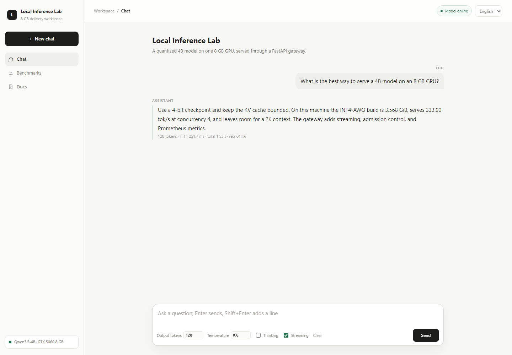
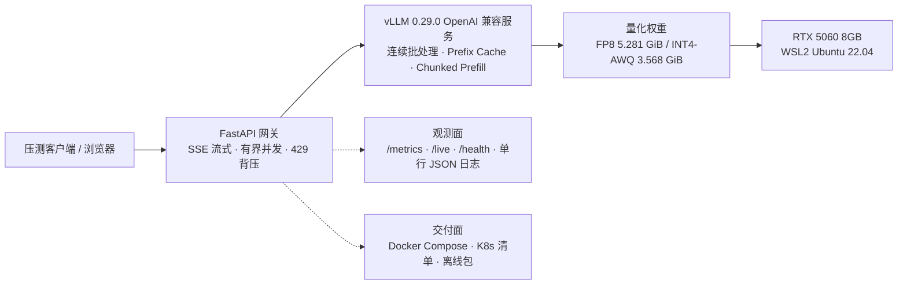
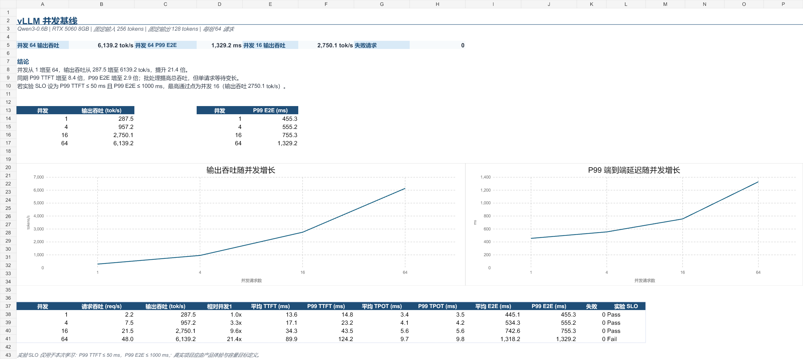

<p align="right">
  
  <a href="README.md"></a>
</p>

# 8GB 大模型推理交付

这是一个从模型到服务的完整推理工程项目：在**单张 RTX 5060 8GB** 上，把 Qwen3.5-4B 从量化、质量评测一路做到服务化、调优和离线交付，并留下足以解释每个取舍的测量数据和原始证据。

**定位：AI Systems / Inference Engineer** —— 让模型适配硬件，再把它做成可观测、可验证的服务。

`vLLM 服务 → 并发压测 → 量化（FP8 / INT4-AWQ）→ 质量评测 → KV Cache 与调度调优 → 推测解码 → FastAPI 生产网关 → Docker 离线交付 → Kubernetes`



## 从这里开始

- [四个数字](#先看四个能说明交付结果的数字)
- [5 分钟复现](#5-分钟复现路径)
- [完整复现指南](docs/REPRODUCE.md)
- [基准协议](docs/BENCHMARK_PROTOCOL.md)
- [Kubernetes 实测](docs/K8S_VERIFICATION.md)
- [性能报告](docs/PERFORMANCE_REPORT.md)

## 范围

这个仓库只讲**一条 8GB 推理交付路径**。

- **范围内：** 量化、质量评测、vLLM 服务、FastAPI 网关、Kubernetes 网关层、可观测性、发布与交付。
- **不在本仓库：** 手写 CUDA 引擎在 [`qwen3.5-fp8-cuda`](https://github.com/francisown/qwen3.5-fp8-cuda)；推理运维 Agent 是 [`experiments/inference-ops-agent/`](experiments/inference-ops-agent/) 里的实验，不属于已验证交付路径。

这里交付的最小单位是一个**可以交给别人运行的推理服务**：模型要装得进显存，质量变化要测得出来，服务上限要看得见，运行方式要能复现。

## 这个项目展示了什么能力

- **显存预算下的量化**：把 Qwen3.5-4B 做成 FP8 和自制 INT4-AWQ 版本，压进 8GB 显卡。
- **用证据做模型选型**：同时比较体积、吞吐、延迟和逐题行为，不把一个准确率数字当成全部结论。
- **推理服务工程**：调优连续批处理、KV Cache、Prefix Cache、Chunked Prefill 和推测解码，再用 FastAPI 网关提供流式输出、超时、背压、探针、指标和结构化日志。
- **本地交付包**：把运行时、网关、Compose、脚本和校验值打成离线包；已在本机 smoke test，但未公开发布。

> **和另外两个仓库的关系**
>
> 同一个人手写了两个从零实现的推理引擎：[qwen3.5-fp8-cuda](https://github.com/francisown/qwen3.5-fp8-cuda) 和 [Qwen3-4B-FP8-Inference](https://github.com/francisown/Qwen3-4B-FP8-Inference)（自研 CUDA 融合算子）。
>
> 那条线讲的是**造引擎**（kernel 级）；**这个仓库讲的是用成熟引擎把模型真正交付出去**（量化取舍、质量评测、服务化、离线包）。两者互补。
>
> **数字不可互相比较**：那边的 `54 tok/s` 是单流自研引擎的数字，这里的 `333.90 tok/s` 是 vLLM 在并发 4 下的批处理吞吐。放在一起比是没有意义的。

---

## 先看四个能说明交付结果的数字

> 门面放**交付模型（Qwen3.5-4B）**的三个结论，以及一个网关稳定性结果。
> Qwen3-0.6B 只作为**引擎批处理能力的测试负载**放在附录 A，不是交付模型数字。吞吐类的绝对数字见下方[「关于数字的可比性」](#关于数字的可比性重要)。

| 模型 | 结论 | 数字 | 证据 |
|---|---|---|---|
| **Qwen3.5-4B**（交付模型） | 自制 INT4-AWQ 把 4B 模型压到 | **3.568 GiB**（比 BF16 小 59%，比 FP8 小 32%） | [`benchmark/eval/README.md`](benchmark/eval/README.md) |
| **Qwen3.5-4B** | 同一套 200 题上，四个版本总分完全相同 | **全部 141/200（70.5%）**，但 INT4 与 BF16 只有 **87.0%** 逐题一致 | [`quantization-final-comparison.csv`](benchmark/eval/quantization-final-comparison.csv) |
| **Qwen3.5-4B** | INT4-AWQ 在并发 4 下的输出吞吐 | **333.90 tok/s**，TTFT p50 **251.73 ms** | [`quantization-final-comparison.csv`](benchmark/eval/quantization-final-comparison.csv) |
| **Gateway + 真实 vLLM** | 2 小时闭环 soak | **67,530 请求，0 错误**，9.379 rps，p95 **458.12 ms**，p99 639.09 ms | [`real-vllm-docker-soak-c4-7200s.json`](benchmark/results/real-vllm-docker-soak-c4-7200s.json) |

第二行是这份工作里最容易被忽略、但最值钱的一条：**四个模型总分相同，不代表它们等价。** 200 题单选题不足以证明模型等价（Wilson 95% 区间 63.84%–76.39%），而 INT4 有 26 道题的选择与 BF16 不同。这个区分决定了你敢不敢在业务里换量化方案。

一个 7.49 GiB 的离线包（模型、CUDA/vLLM 用户态、网关、Compose 和校验值）在本机构建并做过 smoke test；它包含模型权重，**没有公开发布**，但内容与 SHA-256 校验值已记录在 [`docs/OFFLINE_BUNDLE.md`](docs/OFFLINE_BUNDLE.md)，拿到副本的人可以核验。公开可复现路径是确定性检查和 CPU-only Compose 演示。

---

## 2026-10-21 实测：部署到了哪一层

| 路径 | 状态 | 证据 |
|---|---|---|
| **Docker + 宿主 vLLM（RTX 5060）** | 已验证（v0.2.4 镜像） | 网关镜像 `v0.2.4` + 真实 Qwen3.5-4B-INT4-AWQ；3 轮 × 20 请求 c=4，0 错误，**325.71 tok/s 均值**，p95 512.92 ms；流式 TTFT p50 **82.4 ms**、p95 98.47 ms；2 小时 soak **67,530 请求、0 错误**、p95 458.12 ms、p99 639.09 ms。原始数据：[`real-vllm-v0.2.4-3runs-summary.json`](benchmark/results/real-vllm-v0.2.4-3runs-summary.json) |
| **Kubernetes 网关，2 副本 + Prometheus** | 已验证（宿主 vLLM） | 集群内 100 请求 0 错误、**326.53 tok/s**；压测中强杀 1 个 Pod，300 请求 0 错误；两个 Pod 均被 Prometheus 抓取；模型服务在集群外 |
| **GPU-in-K8s vLLM + gateway（WSL2 k3s）** | 仅短 smoke | vLLM Pod 占 `nvidia.com/gpu: 1`，2 个 gateway Pod；集群内 100 请求 0 错误、**147.17 tok/s**、p95 3.02s；流式 TTFT p50 91.8 ms。约 6 小时后 k3s 节点变成 `NotReady`（flannel/PLEG），因此**不声称**长稳 serving。见 [`benchmark/results/k8s-gpu/`](benchmark/results/k8s-gpu/) |
| **HPA 2→4 / 4→2** | 已验证 | c=32 的 8,000 请求 0 错误；CPU 198%/60%；45s 扩容、90s 缩容；mock 上游，只验证 HPA 机制 |
| **滚动更新 / 回滚** | 已验证 | 坏镜像 `v2` 停在 `ImagePullBackOff`，两个旧副本继续服务；`rollout undo` 恢复 |
| **TensorRT-LLM 对比** | 未测量 | TensorRT-LLM 1.2.1 的 support matrix 不覆盖 Qwen3.5 或 RTX 5060/SM120，CUDA/torch 要求也不同；不声称未支持的 benchmark。见 [`docs/RUNTIME_COMPARISON.md`](docs/RUNTIME_COMPARISON.md) |

完整命令、原始结果和限制见 [`docs/K8S_VERIFICATION.md`](docs/K8S_VERIFICATION.md) 与 [`benchmark/results/k8s-gpu/`](benchmark/results/k8s-gpu/)。最早的 gateway benchmark 用宿主 vLLM；WSL2 k3s 这一轮把 vLLM 也放进了集群，短 smoke 功能通过，但吞吐和尾延迟明显差于宿主路径，因此不声称生产可用或性能等价。

---

## 架构



这张图是最早的宿主 vLLM 路径。把 vLLM 和 gateway 都放进集群的 WSL2 k3s
变体在 [`k8s/gpu-inference/`](k8s/gpu-inference/)，其实测性能低于宿主路径。

---

## 关键结果

所有数字只适用于本机硬件、vLLM 0.29.0 和对应的测试条件，不应外推到其他 GPU 或长上下文业务。

### 1. 量化三向对比：总分相同，行为不同

统一使用 C-Eval `val` 固定 200 题（覆盖 52 个科目，样本 SHA-256 `8df8746b…c941`），校准集用互不重叠的 `dev` 以避免数据泄漏；提示词、题序、答案解析、`temperature=0`、关闭思考、最多 8 个输出 token 全部固定。

| 模型 | 目录大小 | 正确率 | 与 BF16 逐题一致 | 修正 BF16 错题 | 损失 BF16 对题 |
|---|---:|---:|---:|---:|---:|
| BF16 参考 | 8.701 GiB | 141/200（70.5%） | 100.0% | — | — |
| 第三方 FP8 | 5.281 GiB | 141/200（70.5%） | 96.5% | 3 | 3 |
| **自制 FP8 v3** | 5.281 GiB | 141/200（70.5%） | **98.0%** | 2 | 2 |
| **自制 INT4-AWQ v1** | 3.568 GiB | 141/200（70.5%） | 87.0% | 11 | 11 |

性能来自同一套公平 benchmark（256in/128out、16 请求、`temperature=0`、编译模式）。**下表是 2026-09-22 同一会话内每配置连跑 3 轮的均值**（n=3）：

| 模型 | 目录大小 | 并发 | 输出吞吐（3 轮均值） | 批内极差 | TTFT P50 | TPOT P50 |
|---|---:|---:|---:|---:|---:|---:|
| 第三方 FP8 | 5.281 GiB | 1 | 72.02 tok/s | 1.3% | 47.92 ms | 13.57 ms |
| 第三方 FP8 | 5.281 GiB | 4 | 256.83 tok/s | 0.1% | 159.49 ms | 14.41 ms |
| 自制 FP8 v3 | 5.281 GiB | 1 | 72.76 tok/s | 0.1% | 48.11 ms | 13.46 ms |
| 自制 FP8 v3 | 5.281 GiB | 4 | 257.33 tok/s | 0.1% | 159.90 ms | 14.39 ms |
| **自制 INT4-AWQ v1** | **3.568 GiB** | 1 | **102.99 tok/s** | 0.1% | 72.24 ms | 9.21 ms |
| **自制 INT4-AWQ v1** | **3.568 GiB** | 4 | **333.90 tok/s** | 0.6% | 251.73 ms | 10.07 ms |

批内极差最大 1.3%、多数 0.1%，说明**这一批内部的测量很稳定**；这是批内精度，不等于外部有效性。下文记录的跨批次漂移说明，绝对数值不应被当作普适结论。

**选型结论：**

- **要在 8GB 上换体积和吞吐 → 自制 INT4-AWQ。**相对第三方 FP8，并发 1 吞吐 **+43.0%**、并发 4 **+30.0%**，两批三次测量下方向与量级都稳定。代价是与 BF16 的逐题一致率更低（87.0% vs 96.5%），这个代价必须在业务侧单独评估。
- **要更贴近 BF16 的行为 → 自制 FP8 v3。**它的优势**只有质量**（与 BF16 逐题一致率 98.0%，高于第三方 FP8 的 96.5%）。**吞吐在本次批内极差内等价**（+1.0% / +0.2%，未做正式统计检验）。

> 早先版本写过「自制 FP8 v3 吞吐略高于第三方 FP8」。这个说法已被两批测量共同推翻，**已从全部文档删除**。现在说「两者吞吐等价」是有 3 轮重复测量支撑的结论，而原来那个说法只有单次数据。

### 2. 推测解码：收益很大，但装不进 8GB

公平实验中 MTP-5 把并发 4 的输出吞吐从 104.26 提到 351.37 tok/s；综合 TTFT、吞吐和接受率，**MTP-4 更值得选**。但 8GB 显存没法同时容纳正式服务的较长上下文、较高并发、CUDA Graph 和激进 MTP，所以稳定交付包退回更保守的 N-gram 配置。

这条结论本身就是产出：**"最优配置"和"能稳定交付的配置"不是同一个东西。**

### 3. 生产网关与交付

`gateway/` 位于客户端与 vLLM 之间，已实现：

- 浏览器聊天页、非流式 `POST /chat`、SSE 流式 `POST /chat/stream`（含 TTFT 与端到端延迟）
- 请求 ID 贯穿、Pydantic 校验、Unicode 清理
- 连接/读/写/连接池四类独立超时；上游错误转换；客户端断开时取消上游
- 有界并发与队列，超限返回 HTTP 429 背压
- 可选 `Authorization: Bearer` / `X-API-Key` 认证；`/live`、`/health`、`/metrics` 保持开放，供探针和 Prometheus 使用
- 可选按身份限流（`GATEWAY_RATE_LIMIT_PER_MINUTE`），以 API Key 或客户端 IP 为身份
- 仅对“发送前的连接失败”重试；读超时绝不重放
- `/live`（进程）与 `/health`（上游依赖）分离；`/gateway/status` 观测在途与排队
- 健康检查使用 `Connection: close` 且禁用 keep-alive 复用（这是 K8s 实测中真实修复的 `RemoteProtocolError` 抖动）
- Prometheus 计数器、Gauge、延迟直方图；`X-Gateway-Pod` / `X-Gateway-Version` 响应头；单行 JSON 应用日志
- **19 个不依赖真实模型和 GPU 的 pytest**，覆盖正常、校验失败、上游超时/断连/HTTP 错误、容量拒绝、排队超时、连接重试、探针身份、可选 API Key 认证与按身份限流
- 非 root Docker 镜像 + Compose；Kubernetes 2 副本、PDB、零停机滚动、按 Pod 的 Prometheus 抓取

离线交付包把模型、vLLM/PyTorch/CUDA 用户态环境、网关、Compose、一键脚本和 SHA-256 校验打在一起，总大小 **7.49 GiB**。它已在本机完成镜像导入、GPU 检查、模型启动和网页对话验证，但**没有公开发布**，读者无法独立核验。

Kubernetes 路径另行于 2026-10-21 实测：集群内 100 请求、并发 4，**0 错误、326.53 tok/s**；压测中强杀 1 个网关 Pod，300 请求 **0 错误**；坏镜像回滚后两个旧副本始终可用。GPU 本身没有被该集群调度。详见 [`docs/K8S_VERIFICATION.md`](docs/K8S_VERIFICATION.md)。

---

## 附录 A · 引擎批处理基线（Qwen3-0.6B — 测试负载，不是交付模型）

**这一节测的是引擎，不是模型。**它不属于交付内容，放在这里只是为了把"连续批处理如何把并发换成吞吐、代价是什么"单独逼出来。

为什么必须用一个轻量负载：要观察批处理本身的扩展性，负载就不能自己先成为瓶颈。Qwen3-0.6B 在 `--max-model-len 4096 --gpu-memory-utilization 0.70` 下能一路拉到并发 64；而 4B 交付模型在 8GB 上、`max-num-seqs 16` 的条件下做不到这一点——显存和 KV cache 会先撞墙。

**所以它的数字不说明交付模型的性能，两者不可互相解释。**固定 256 input / 128 output，共 64 个请求：

> 下表为**单次测量**，未做 3 轮重复（与交付模型那两张表不同）。附录这个结论只依赖"吞吐随并发大幅上升、延迟同时恶化"这个趋势，不依赖具体数值，所以单次足够；但**不要把这里的绝对数字当作精确值引用**。

| 客户端并发 | 输出吞吐 | TTFT P50 | TTFT P95 | TPOT P50 | 成功率 |
|---:|---:|---:|---:|---:|---:|
| 1 | 265.76 tok/s | 14.95 ms | 15.51 ms | 3.67 ms | 100% |
| 4 | 898.85 tok/s | 18.02 ms | 23.64 ms | 4.32 ms | 100% |
| 16 | 2,811.97 tok/s | 33.84 ms | 41.88 ms | 5.47 ms | 100% |
| 64 | 5,693.04 tok/s | 94.50 ms | 120.18 ms | 10.48 ms | 100% |



并发 1 到 64，总吞吐涨了 21.4 倍，但每个请求的 TPOT 涨了 2.9 倍、TTFT 涨了 6.3 倍。**"能接收 64 个并发"和"64 个用户都保持单用户延迟"是两件事**，容量规划必须把这条曲线当成一个取舍，而不是一个上限。

这条结论与模型世代无关，是这个附录唯一值得看的东西。

---

## 5 分钟复现路径

```bash
# 1. 确定性自测（不需要 GPU、模型或 API Key）
python -m pip install -r gateway/requirements-dev.txt pyyaml
python scripts/verify_local.py          # 预期：5 个成本测试 + 19 个网关测试
python scripts/validate_manifests.py    # 预期：58 个 Kubernetes 文档

# 1b. 质量门禁（与 CI 相同）
python -m ruff check gateway tools tests                    # 预期：All checks passed
python -m mypy gateway/gateway.py                           # 预期：no issues found
python -m pytest -q gateway --cov=gateway --cov-fail-under=65

# 2. 从原始 JSON 复算吞吐与成本（在仓库根执行）
python tools/cost_calculator.py \
  --benchmark-json benchmark/results/qwen35-int4-awq-self-compiled-c4.json \
  --gpu-hour-price 1 --currency CNY

# 3. Kubernetes 路径（需要集群；完整命令见 docs/K8S_VERIFICATION.md）
kubectl apply -k k8s
kubectl apply -k k8s/observability
```

要跑完整链路（需要 GPU + WSL2 + vLLM）见 [docs/project-notes.md](docs/project-notes.md) 的「可复现环境」一节。四份逐题的量化评测原始结果在 [`benchmark/eval/`](benchmark/eval/)，性能原始 JSON 在 [`benchmark/results/`](benchmark/results/)。

## 发布

- 最新版本：**v0.2.4** —— [release notes](https://github.com/francisown/8gb-llm-inference-delivery/releases/tag/v0.2.4)
- 镜像：`ghcr.io/francisown/8gb-llm-inference-delivery/gateway:v0.2.4`
- Digest：`sha256:4453ef462ac426b6abe239819d41a4171454f7ebffacaf90ffb481a8f95e1365`
- 详情：[`docs/RELEASE.md`](docs/RELEASE.md)

最早的 K8s 网关实测是在 **v0.2.0** 上完成的；v0.2.1 增加 API Key 认证，v0.2.2 增加 TLS/告警/OTel，v0.2.3 增加按身份限流，v0.2.4 加固认证/限流身份处理与畸形上游响应，不改变服务路径。

## 可观测性 demo（不需要 GPU）

CPU-only 栈用 mock OpenAI 兼容上游，不需要模型权重就能验证指标链路：

```bash
bash deploy/observability/generate-certs.sh
docker compose -f deploy/observability/compose.yaml up -d --build
# Grafana:    http://localhost:3000  (admin/admin)
# Prometheus: http://localhost:9090
# Alertmanager: http://localhost:9093
# Webhook:    http://localhost:8080  (告警接收端)
# Jaeger:     http://localhost:16686
# HTTPS:      https://localhost:9443  (自签证书；curl -k)
# Gateway:    http://localhost:9000
```

Dashboard 包含请求速率/错误率、TTFT p50/p95、端到端延迟、排队等待、准入控制、上游健康、completion tokens/s 和网关副本。真实 GPU 路径把 `VLLM_BASE_URL` 指向 vLLM 服务即可。

可重复的 gateway soak：

```bash
python benchmark/soak_test.py --url http://127.0.0.1:9000/chat \
  --duration 120 --concurrency 4 \
  --output benchmark/results/observability/soak-c4-120s.json
```

---

## 目录导航

> **命名约定**：本仓库所有路径**按功能命名，不按时间命名**。早期用过 `week1/`、`week6_api/` 这类"学习计划第几周"的标签，已经全部改掉——时间标签在项目跨越多个阶段之后必然变成错的（`week1` 后来实际涵盖全部模块），而功能名不会过期。

| 路径 | 内容 |
|---|---|
| [`docs/article-quantization-on-8gb-zh.md`](docs/article-quantization-on-8gb-zh.md) · [`docs/article-quantization-on-8gb-en.md`](docs/article-quantization-on-8gb-en.md) | **技术长文（中英）**：完整的量化和排查过程，含三次自我推翻 |
| [`docs/one-pager-zh.md`](docs/one-pager-zh.md) · [`docs/one-pager-en.md`](docs/one-pager-en.md) | 一页纸项目说明（中英），对外沟通用 |
| [`docs/parameter-decisions.md`](docs/parameter-decisions.md) | 每个推理参数为什么取这个值，以及哪些数字可对外引用 |
| [`docs/project-notes.md`](docs/project-notes.md) | 主文档：模块状态、可复现环境、量化与推测解码细节 |
| [`docs/K8S_VERIFICATION.md`](docs/K8S_VERIFICATION.md) | Kubernetes 实测记录：部署、压测、Pod 强杀、回滚、Prometheus 与 GPU 调度边界 |
| [`docs/RUNTIME_COMPARISON.md`](docs/RUNTIME_COMPARISON.md) | vLLM / TensorRT-LLM / 自研 CUDA 的对比状态与不可比原因 |
| [`docs/K3S_GPU_EXPERIMENT.md`](docs/K3S_GPU_EXPERIMENT.md) | WSL2 k3s GPU 尝试：PLEG 失败、VLLM_PORT 修复与后续短验证 |
| [`docs/LINUX_GPU_RUNBOOK.md`](docs/LINUX_GPU_RUNBOOK.md) | 真实 Linux GPU 节点步骤：驱动、toolkit、device plugin、PVC、vLLM、TensorRT-LLM |
| [`docs/PERFORMANCE_REPORT.md`](docs/PERFORMANCE_REPORT.md) | 性能报告：量化、K8s 网关、故障处理与不声称的内容 |
| [`docs/BENCHMARK_PROTOCOL.md`](docs/BENCHMARK_PROTOCOL.md) | 所有主数字的单一协议矩阵与可比性规则 |
| [`benchmark/README.md`](benchmark/README.md) | 哪些 benchmark/eval 文件是权威结果，哪些是历史归档 |
| [`scripts/README.md`](scripts/README.md) | 脚本清单：当前校验、实验驱动与历史工具 |
| [`CHANGELOG.md`](CHANGELOG.md) | 版本变更与发布说明 |
| [`docs/FLAGSHIP_PLAN.md`](docs/FLAGSHIP_PLAN.md) | 当前旗舰计划与验证清单 |
| [`benchmark/eval/`](benchmark/eval/) | 冻结的 200 题清单、四个模型的逐题原始结果、三向总表 |
| [`benchmark/results/`](benchmark/results/) | 全部性能原始 JSON（并发 sweep、长上下文、推测解码、真实多轮对话） |
| [`benchmark/results/k8s-gpu/`](benchmark/results/k8s-gpu/) | WSL2 k3s GPU-in-K8s vLLM + gateway 验证与原始结果 |
| [`benchmark/hpa/README.md`](benchmark/hpa/README.md) | HPA 2→4→2 实测：mock 上游、metrics-server、压测 Job |
| [`benchmark/k8s_load_test.py`](benchmark/k8s_load_test.py) | 集群内/端口转发压测脚本：TTFT、延迟分位、错误率、Pod 分布 |
| [`benchmark/soak_test.py`](benchmark/soak_test.py) | 闭环 gateway soak：延迟分位、错误率、active/waiting 归零检查 |
| [`gateway/`](gateway/) | FastAPI 网关、网页、Dockerfile、离线 pytest |
| [`docs/SLO.md`](docs/SLO.md) | SLO 目标、PromQL、错误预算策略与 dashboard 链接 |
| [`docs/TLS.md`](docs/TLS.md) | 本地 TLS 终止、验证与生产建议 |
| [`docs/K8S_TLS.md`](docs/K8S_TLS.md) | Kubernetes 上的 TLS 终止与 NetworkPolicy 开关对照 |
| [`docs/HPA_QUEUE.md`](docs/HPA_QUEUE.md) | 队列深度 HPA、外部指标配置陷阱与扩容测试 |
| [`docs/ALERTING.md`](docs/ALERTING.md) | Prometheus 告警规则、验证与 runbook |
| [`docs/OTEL.md`](docs/OTEL.md) | Jaeger tracing、OTLP 配置、验证与限制 |
| [`docs/RELEASE_CHECKLIST.md`](docs/RELEASE_CHECKLIST.md) | 发布前、canary、回滚、制品与发布后检查清单 |
| [`docs/REPRODUCE.md`](docs/REPRODUCE.md) | 三层复现路径、环境版本与已知缺口 |
| [`docs/OFFLINE_BUNDLE.md`](docs/OFFLINE_BUNDLE.md) | 7.49 GiB 离线包内容、SHA-256 校验值与验证记录 |
| [`requirements-quant.txt`](requirements-quant.txt) | 量化环境的人类可读起点 |
| [`requirements-quant.lock.txt`](requirements-quant.lock.txt) | 量化/评测环境的实际 pip freeze（88 包） |
| [`requirements-vllm.lock.txt`](requirements-vllm.lock.txt) | vLLM 服务环境的实际 pip freeze（205 包） |
| [`docs/RELEASE.md`](docs/RELEASE.md) | v0.2.4 tag、GHCR 镜像、发布验证与部署说明 |
| [`experiments/inference-ops-agent/`](experiments/inference-ops-agent/) | 可选的推理运维 Agent 实验，不属于已验证交付路径 |
| [`SECURITY.md`](SECURITY.md) | 漏洞报告、Secret 策略、范围与已知限制 |
| [`CONTRIBUTING.md`](CONTRIBUTING.md) | 本地检查、可观测性 demo、soak、PR 清单与发布流程 |
| [`.github/workflows/release.yml`](.github/workflows/release.yml) | tag 触发的 GHCR 镜像构建与发布 |
| [`deploy/observability/`](deploy/observability/) | CPU-only Compose demo：mock vLLM + 网关 + Prometheus + 已配置的 Grafana dashboard |
| [`k8s/`](k8s/) | 网关 Deployment / Service / ConfigMap / 探针 / PDB / HPA / NetworkPolicy / Prometheus / 压测 Job |
| [`k8s/gpu-inference/`](k8s/gpu-inference/) | WSL2 k3s 的 vLLM-on-GPU + 2 gateway 副本清单 |
| [`k8s/tls-demo/`](k8s/tls-demo/) | Docker Desktop Kubernetes 上的 Nginx TLS 终止与生效的 NetworkPolicy |
| [`k8s/hpa-queue-demo/`](k8s/hpa-queue-demo/) | 通过 Prometheus Adapter 外部指标实现的队列深度 HPA |
| [`.github/workflows/ci.yml`](.github/workflows/ci.yml) | 测试、清单/工作流校验、Kustomize 渲染与 Docker 构建 |
| [`scripts/validate_workflows.py`](scripts/validate_workflows.py) | 确定性的 GitHub Actions YAML 校验 |
| [`quantize_fp8_block.py`](quantize_fp8_block.py) | FP8_BLOCK 量化脚本 |
| [`quantize_int4_awq.py`](quantize_int4_awq.py) | W4A16 INT4-AWQ 量化脚本（C-Eval 校准、逐层校准、CPU offload） |
| [`ceval_quality_eval.py`](ceval_quality_eval.py) | 评测入口：固定题集、断点续跑、逐题原子保存 |
| [`docs/int4-awq-experiment-log.md`](docs/int4-awq-experiment-log.md) | AWQ 实验记录，含踩坑与修复 |
| [`tools/cost_calculator.py`](tools/cost_calculator.py) | 容量成本估算（直读 benchmark JSON） |

---

## 这个仓库是什么，不是什么

**是：**一个人在一张 8GB 消费级显卡上，把推理服务的量化、调优、服务化和交付完整走了一遍，并且每一步都留了可复算的原始数据。

**不是：**论文复现、模型训练、也不是有 SLA 承诺的生产系统。具体地：

- BF16 的 8.701 GiB checkpoint 装不进 8GB 显存，它用 Transformers 分层放在 CPU 上以固定 batch size 4 完成质量基线，**它的本地延迟不能和 GPU 常驻的 vLLM 模型比较**。
- 200 道单选题只能说明在这 200 题上没观察到准确率差异，**不足以证明模型等价**；自由文本、代码、长上下文和真实业务数据都需要单独评测。
- 成本计算器是容量成本估算，不含空闲波动、网络、存储、人工、税费、冗余和利润，**不能冒充云 API 的完整报价**。
- **WSL2 上 pinned memory 是受支持的，只是 vLLM 默认关闭**，需要设 `VLLM_WSL2_ENABLE_PIN_MEMORY=1`；打开后服务端会 `Using V2 Model Runner`。实测 V2 与 V1 runner 性能等价（并发 1 差 -0.3%，并发 4 差 -0.1%）。另外本机没有完整 CUDA Toolkit，FlashInfer sampler 首次 JIT 会失败，因此需设 `VLLM_USE_FLASHINFER_SAMPLER=0`。这些是本机环境的配置，不是通用建议。详见 [`docs/wsl2-runner-verification.md`](docs/wsl2-runner-verification.md)。

### 关于数字的可比性（重要）

本仓库的性能数字**只有同一批次、且同配置测 ≥3 轮**的才可靠。

**为什么会得出这个规矩**：2026-09-17 记录的数字在 2026-09-22 用完全相同的参数复测（`num_prompts`、并发、输入输出长度、`completed`、`failed` 已逐项核对一致），结果对不上，而且**对不上的方式不均匀**：

| 配置 | 并发 1 | 并发 4 |
|---|---:|---:|
| Qwen3.5-4B **第三方 FP8** | **+0.7%** | **+2.6%** |
| Qwen3.5-4B 自制 FP8 v3 | -7.2% | -5.7% |
| Qwen3.5-4B 自制 INT4-AWQ | -5.6% | -7.2% |
| Qwen3-0.6B（并发 1/4/16/64） | -7.6% / -6.1% / +2.2% / -7.3% | |

（上表用 3 轮均值。正向百分比表示新值更高。这里**不能判断哪一批"更正确"**——只能判断旧值在当前环境下复现不出来。）

**第三方 FP8 基本没变，两个自制量化模型一起低 6–7%。**如果只是"整台机器慢了一档"，第三方也该跟着掉。所以这不是单一环境因子，而与量化内核路径相关（两个自制模型都走 compressed-tensors + Marlin）。

**已经排除的原因：热降频。**记录的 GPU 状态是 `throttle_reasons = 0x0000000000000000`（无任何降频原因）、温度 49–64 °C、功耗 78–105 W（上限 145 W）、SM 时钟全程 2535→2752 MHz 稳定不上不下。**"GPU 变热降频"这个解释被数据否掉了。**

**尚未确定的原因**：候选是不同批次之间量化内核的自动调优与预热状态不同。**未验证**，不当作结论使用。

**这个差异是真实的，不是单次波动**——重复测量给出了决定性证据：

| 配置 | 3 个样本的批内极差 |
|---|---:|
| 第三方 FP8（并发 1 / 4） | 1.3% / 0.1% |
| 自制 FP8 v3（并发 1 / 4） | 0.1% / 0.1% |
| 自制 INT4（并发 1 / 4） | 0.1% / 0.6% |

批内极差小到 0.1%，却稳定地偏离旧值 6–7%。**所以旧值不是"运气差"，而是当前配置下复现不出来。**

**同时暴露的一个方法论要点**：单次测量不可靠，**即使同一天也不行**。当天早些时候的单次测量里，自制 FP8 v3 并发 4 得到 246.66，而 3 轮均值是 257.33——偏离 4.3%，远超其 0.1% 的批内极差。另外第一批测量普遍略低（第三方 FP8 并发 1 的首轮 71.5 vs 后两轮 72.2/72.4），像是预热效应。

> **结论性规矩：对外引用的性能数字，同批次内每配置至少跑 3 轮取均值。**本表的数字遵守这条规矩。

**相对关系的变化**：

| 相对关系 | 2026-09-17 | 2026-09-22（3 轮均值） |
|---|---:|---:|
| 自制 INT4 ÷ 第三方 FP8（并发 1） | 1.53× | 1.43× |
| 自制 INT4 ÷ 第三方 FP8（并发 4） | 1.44× | 1.30× |
| 自制 FP8 v3 ÷ 第三方 FP8（并发 1） | 1.10× | 1.01× |
| 自制 FP8 v3 ÷ 第三方 FP8（并发 4） | 1.09× | **1.00×** |

- INT4 的优势从约 +52.6% / +43.7% 收窄到 **+43.0% / +30.0%**，方向与量级都稳定
- 「自制 FP8 v3 吞吐略高于第三方 FP8」**已被推翻**。现在两轮独立测量的结论一致：**两者吞吐等价**，选型只能看质量

**不受影响的结论**：体积压缩、200 题质量一致率、显存预算计算、参数选择理由——这些都不是吞吐测量，不随批次变化。

完整的排查过程、GPU 状态原始记录与所有脚本见 [`docs/wsl2-runner-verification.md`](docs/wsl2-runner-verification.md)。

---

## 可复现环境

| 项 | 版本 |
|---|---|
| 宿主 | Windows + WSL2（Ubuntu 22.04） |
| GPU | NVIDIA GeForce RTX 5060 8GB |
| 推理引擎 | vLLM 0.29.0 |
| PyTorch | 2.13.0+cu130 |
| CUDA runtime | 13.0 |

模型权重与数据集不入库（见 `.gitignore`）。

---

## 当前状态

| 模块 | 状态 |
|---|---|
| vLLM 与核心机制、并发压测、FP8/INT4 量化、质量评测、KV Cache 与调度、生产网关、Docker 离线交付、成本模型 | 完成 |
| Kubernetes 网关层 | **2026-10-21 已验证**：2 副本、Service、探针、PDB、零停机滚动/回滚、按 Pod 的 Prometheus、HPA 2→4→2；100 请求 0 错误，压测中强杀 Pod 的 300 请求 0 错误。见 [`docs/K8S_VERIFICATION.md`](docs/K8S_VERIFICATION.md) 与 [`benchmark/hpa/README.md`](benchmark/hpa/README.md) |
| Kubernetes 调度 GPU | **仅短 smoke**：节点广告 `nvidia.com/gpu: 1`；vLLM Pod 服务真实 Qwen3.5-4B-INT4-AWQ；2 个 gateway Pod；100 请求 0 错误、147.17 tok/s、p95 3.02s。约 6 小时后 WSL2 k3s 节点变成 `NotReady`（flannel/PLEG），不声称长稳 GPU serving。见 [`benchmark/results/k8s-gpu/`](benchmark/results/k8s-gpu/) |
| 可观测性与 SRE | Prometheus/Grafana/Alertmanager 与真实 webhook 投递（firing 与 resolved 的 POST 均已记录）、SLO/错误预算文档、2 小时真实 vLLM soak（67,530 请求、0 错误、p95 458.12 ms）、2 小时 mock gateway soak（140,178 请求、0 错误）、c=16 背压、OTel/Jaeger badger 持久化；仍无多小时 GPU-in-Kubernetes soak |
| CI/CD | CI（测试、清单/工作流/文档校验、Kustomize 渲染、Docker 构建）+ tag 触发的 GHCR 发布工作流（v0.2.4 已发布）；尚无镜像签名与自动部署 |
| TensorRT-LLM | 未测量；对比协议与 harness 见 [`docs/RUNTIME_COMPARISON.md`](docs/RUNTIME_COMPARISON.md) |
| 云与治理 | 未开始 |

网关镜像 `v0.2.4` 已重新对着真实模型验证：20 请求 c=4、0 错误、327.51 tok/s、流式 TTFT p50 85.5 ms。若重新发布离线包，需要刷新其中的网关镜像与 SHA-256 校验值。
